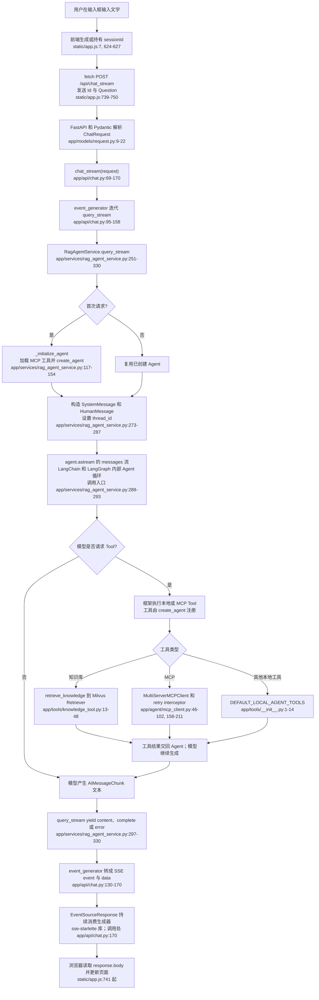

# 两类 Agent 的端到端调用链

本文只描述当前仓库实际执行的两条流式链路：

1. 对话 RAG Agent：`POST /api/chat_stream`。
2. AIOps Agent：`POST /api/aiops`。

图中的 `文件:行号` 是当前代码位置。Mermaid 图负责展示控制流；图后的步骤说明提供精确的可点击源码链接。标为“LangChain/LangGraph 内部”的步骤由第三方库执行，不在本仓库内。

## 一、对话 RAG Agent：`/api/chat_stream`

### 步骤解释

1. 前端在创建 `SuperBizAgentApp` 时生成 `sessionId`；它不是用户输入。新建会话时也会重新生成。见 [static/app.js:7](/Users/heng/Desktop/master/agent_project/Oncall_agent/static/app.js:7) 和 [static/app.js:624](/Users/heng/Desktop/master/agent_project/Oncall_agent/static/app.js:624)。

2. 用户输入文字保存在 `message`，前端把它连同 `this.sessionId` 序列化为 JSON：`{ Id, Question }`，再通过 `fetch` 发给后端。见 [static/app.js:739](/Users/heng/Desktop/master/agent_project/Oncall_agent/static/app.js:739)。

3. FastAPI 根据函数参数类型 `ChatRequest` 自动读取 JSON 请求体。Pydantic 使用别名把外部字段 `Id`、`Question` 分别映射为内部属性 `request.id`、`request.question`。见 [app/models/request.py:9](/Users/heng/Desktop/master/agent_project/Oncall_agent/app/models/request.py:9) 和 [app/api/chat.py:69](/Users/heng/Desktop/master/agent_project/Oncall_agent/app/api/chat.py:69)。

4. `chat_stream()` 不立即生成完整回答；它定义 `event_generator()`。这个异步生成器持续从 `rag_agent_service.query_stream()` 读取内部事件，每次 `yield` 一条符合 SSE 格式的字典。见 [app/api/chat.py:93](/Users/heng/Desktop/master/agent_project/Oncall_agent/app/api/chat.py:93)。

5. `query_stream()` 首先确保 Agent 已初始化。首次请求会加载 MCP 工具，并将“本地工具 + MCP 工具”传给 `create_agent()`；后续请求复用 `self.agent`。见 [app/services/rag_agent_service.py:117](/Users/heng/Desktop/master/agent_project/Oncall_agent/app/services/rag_agent_service.py:117)。

6. 服务构造一条 `SystemMessage` 和一条 `HumanMessage`，并把前端 session ID 作为 LangGraph `thread_id`。这使同一会话在**当前进程的** `MemorySaver` 中关联状态。见 [app/services/rag_agent_service.py:273](/Users/heng/Desktop/master/agent_project/Oncall_agent/app/services/rag_agent_service.py:273)。

7. `self.agent.astream(..., stream_mode="messages")` 进入 LangChain/LangGraph 的内部 Agent 运行循环。该循环会调用模型；如果模型返回 `tool_calls`，框架执行 Tool、把结果写成 ToolMessage，再让模型继续回答。项目中能定位的入口是 [app/services/rag_agent_service.py:289](/Users/heng/Desktop/master/agent_project/Oncall_agent/app/services/rag_agent_service.py:289)，但循环实现属于第三方库。

8. 当模型选择知识库工具时，`retrieve_knowledge` 通过 `VectorStore.as_retriever()` 从 Milvus 查询文档，格式化后把资料返回给 Agent。见 [app/tools/knowledge_tool.py:13](/Users/heng/Desktop/master/agent_project/Oncall_agent/app/tools/knowledge_tool.py:13)。模型也可能选择时间、Prometheus 或 MCP 工具；它是否调用 RAG 由模型决定，不是每轮必检索。

9. `query_stream()` 从 AIMessage/AIMessageChunk 中提取文本，`yield {"type": "content" ...}`；结束时再 `yield {"type": "complete"}`，异常时产出 `error`。见 [app/services/rag_agent_service.py:297](/Users/heng/Desktop/master/agent_project/Oncall_agent/app/services/rag_agent_service.py:297)。

10. API 层把内部事件转为 SSE 的 `event: message` 和 JSON `data`。`EventSourceResponse` 是 `sse-starlette` 的库类：它在内部反复消费 `event_generator`，并把每次 `yield` 推送给浏览器。见 [app/api/chat.py:130](/Users/heng/Desktop/master/agent_project/Oncall_agent/app/api/chat.py:130) 和 [app/api/chat.py:170](/Users/heng/Desktop/master/agent_project/Oncall_agent/app/api/chat.py:170)。

## 二、AIOps Agent：`/api/aiops`

```mermaid
flowchart TD
    A["用户点击 AIOps 诊断"] --> B["前端 POST /api/aiops<br/>发送 session_id<br/>static/app.js:1179-1189"]
    B --> C["FastAPI 解析 AIOpsRequest<br/>app/models/aiops.py:8-19"]
    C --> D["diagnose_stream 取得 session_id<br/>app/api/aiops.py:124-153"]
    D --> E["event_generator 迭代 aiops_service.diagnose<br/>app/api/aiops.py:127-153"]
    E --> F["diagnose 固定诊断任务后调用 execute<br/>app/services/aiops_service.py:248"]
    F --> G["初始化 PlanExecuteState 并设置 thread_id<br/>app/services/aiops_service.py:81-118"]
    G --> H["已编译的 StateGraph<br/>节点和边 app/services/aiops_service.py:29-79"]
    H --> I["Planner<br/>app/agent/aiops/planner.py:70-159"]
    I --> I1["先检索知识库经验<br/>planner.py:77-90"]
    I1 --> I2["获取本地和 MCP 工具<br/>planner.py:92-105"]
    I2 --> I3["LLM Structured Output 生成 Plan<br/>planner.py:121-148"]
    I3 --> J["Executor<br/>app/agent/aiops/executor.py:20-112"]
    J --> J1["取 plan[0] 并绑定 Tools<br/>executor.py:26-58"]
    J1 --> J2["LLM 决定是否 Tool Call<br/>executor.py:78-97"]
    J2 --> J3{"是否调用工具?"}
    J3 -->|是| J4["ToolNode 执行工具，再让模型总结<br/>executor.py:83-93"]
    J3 -->|否| J5["直接使用模型文本<br/>executor.py:94-97"]
    J4 --> J6["更新 plan 与 past_steps<br/>executor.py:101-105"]
    J5 --> J6
    J6 --> K["Replanner<br/>app/agent/aiops/replanner.py:120-239"]
    K --> K1["LLM 输出 continue、replan 或 respond<br/>replanner.py:172-230"]
    K1 --> K2{"条件边 should_continue<br/>aiops_service.py:49-73"}
    K2 -->|有剩余 plan| J
    K2 -->|response 非空| L["END"]
    K2 -->|plan 空且没有 response| L
    L --> M["获取最终 State，并 yield complete<br/>app/services/aiops_service.py:135-157"]
    M --> N["API yield SSE；遇 complete 或 error 后 break<br/>app/api/aiops.py:127-153"]
    N --> O["EventSourceResponse 推送浏览器<br/>sse-starlette 库；调用处 aiops.py:153"]
```

### 步骤解释

1. 前端 AIOps 请求只传当前 `sessionId`，没有传任意自然语言任务；后端会使用固定的“诊断当前系统告警”任务模板。见 [static/app.js:1179](/Users/heng/Desktop/master/agent_project/Oncall_agent/static/app.js:1179)、[app/api/aiops.py:124](/Users/heng/Desktop/master/agent_project/Oncall_agent/app/api/aiops.py:124) 和 [app/services/aiops_service.py:248](/Users/heng/Desktop/master/agent_project/Oncall_agent/app/services/aiops_service.py:248)。

2. `diagnose_stream()` 内部生成器持续迭代 `aiops_service.diagnose()`；每一项状态事件被 JSON 序列化后 `yield` 给 `EventSourceResponse`。当事件类型是 `complete` 或 `error`，才退出循环并关闭 SSE。见 [app/api/aiops.py:127](/Users/heng/Desktop/master/agent_project/Oncall_agent/app/api/aiops.py:127)。

3. `diagnose()` 将固定任务交给通用 `execute()`；`execute()` 创建初始 `PlanExecuteState`：`input`、`plan`、`past_steps`、`response`，并以 session ID 作为 `thread_id`。State 的字段定义和 `past_steps` 追加规则见 [app/agent/aiops/state.py:10](/Users/heng/Desktop/master/agent_project/Oncall_agent/app/agent/aiops/state.py:10)，运行入口见 [app/services/aiops_service.py:81](/Users/heng/Desktop/master/agent_project/Oncall_agent/app/services/aiops_service.py:81)。

4. 图在服务创建时已经定义：入口是 Planner，固定边为 `Planner → Executor → Replanner`；Replanner 的条件边决定回到 Executor 或结束。见 [app/services/aiops_service.py:29](/Users/heng/Desktop/master/agent_project/Oncall_agent/app/services/aiops_service.py:29)。

5. Planner **主动**查询知识库经验，再获取本地与 MCP 工具清单，然后通过 `with_structured_output(Plan)` 请求模型输出计划列表。这与 RAG 对话 Agent 不同：后者是否检索由模型决定。见 [app/agent/aiops/planner.py:77](/Users/heng/Desktop/master/agent_project/Oncall_agent/app/agent/aiops/planner.py:77) 和 [app/agent/aiops/planner.py:121](/Users/heng/Desktop/master/agent_project/Oncall_agent/app/agent/aiops/planner.py:121)。

6. Executor 每次只处理 `plan[0]`。模型先决定是否调用工具；有调用时 `ToolNode` 执行并把结果交回模型，得到当前步骤的文字结果；无调用时直接采用模型文本。最后移除该步骤，并将 `(步骤, 结果)` 追加到 `past_steps`。见 [app/agent/aiops/executor.py:26](/Users/heng/Desktop/master/agent_project/Oncall_agent/app/agent/aiops/executor.py:26)、[app/agent/aiops/executor.py:78](/Users/heng/Desktop/master/agent_project/Oncall_agent/app/agent/aiops/executor.py:78) 和 [app/agent/aiops/executor.py:101](/Users/heng/Desktop/master/agent_project/Oncall_agent/app/agent/aiops/executor.py:101)。

7. Replanner 读取剩余计划和已完成步骤，输出三种动作：`continue`、`replan` 或 `respond`。达到 8 步会强制生成最终回复；已执行达到 5 步时禁止继续 replan。见 [app/agent/aiops/replanner.py:120](/Users/heng/Desktop/master/agent_project/Oncall_agent/app/agent/aiops/replanner.py:120) 和 [app/agent/aiops/replanner.py:172](/Users/heng/Desktop/master/agent_project/Oncall_agent/app/agent/aiops/replanner.py:172)。

8. 条件边并不读取 Replanner 的“action”字段本身，而是读取合并后的 State：`response` 非空则结束；否则如果 `plan` 还有步骤则返回 Executor。见 [app/services/aiops_service.py:49](/Users/heng/Desktop/master/agent_project/Oncall_agent/app/services/aiops_service.py:49)。这也是为什么 Replanner 的 `continue` 返回空字典后，图仍会继续执行。

9. `execute()` 使用 `stream_mode="updates"` 接收每个节点的状态增量，将其格式化为 UI 事件；图结束后从 Checkpoint 读取最终状态，再额外 `yield complete`。见 [app/services/aiops_service.py:114](/Users/heng/Desktop/master/agent_project/Oncall_agent/app/services/aiops_service.py:114) 和 [app/services/aiops_service.py:135](/Users/heng/Desktop/master/agent_project/Oncall_agent/app/services/aiops_service.py:135)。

10. 最终仍由 `EventSourceResponse` 持续消费 API 的 `event_generator()` 并向浏览器推送。这是库的循环；项目代码只定义每一步产出的 SSE 数据。见 [app/api/aiops.py:127](/Users/heng/Desktop/master/agent_project/Oncall_agent/app/api/aiops.py:127) 和 [app/api/aiops.py:153](/Users/heng/Desktop/master/agent_project/Oncall_agent/app/api/aiops.py:153)。

## 三、两条链路最重要的差异

| 维度 | 对话 RAG Agent | AIOps Agent |
|---|---|---|
| 入口 | 用户文字问题 | 固定诊断任务 + session ID |
| Agent 形态 | `create_agent()` 的框架内置循环 | 显式 `StateGraph` |
| RAG 触发 | 模型自行决定是否调用知识工具 | Planner 每次先主动检索 |
| 流模式 | `messages`，主要传模型文本块 | `updates`，主要传节点状态更新 |
| 终止条件 | 框架 Agent 得到最终消息 | Replanner 写入 `response` 或图无剩余计划 |
| 会话状态 | `MemorySaver` + `thread_id` | `MemorySaver` + `thread_id` |

两者当前都使用进程内 `MemorySaver`。服务重启后 Checkpoint 会丢失；它也不等于跨会话长期记忆。后续改造参见 [持久化 Checkpoint](advanced/01-persistent-checkpoint.md) 与 [长期记忆](advanced/02-long-term-memory.md)。
