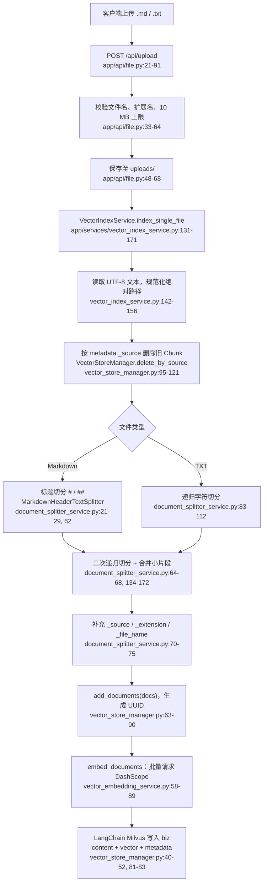
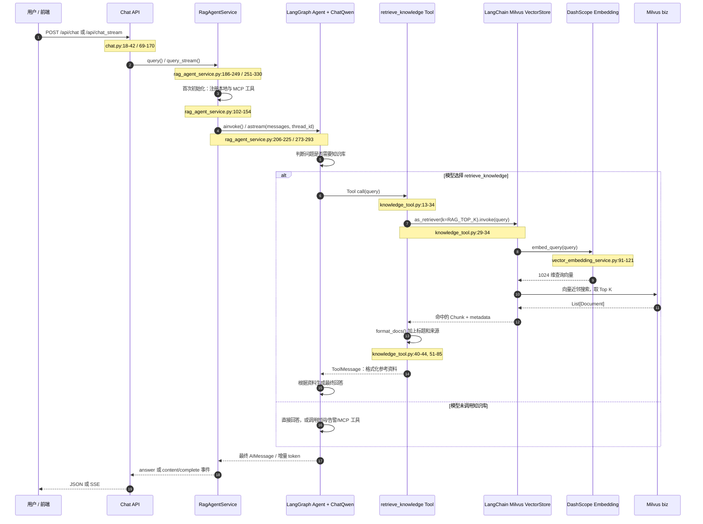
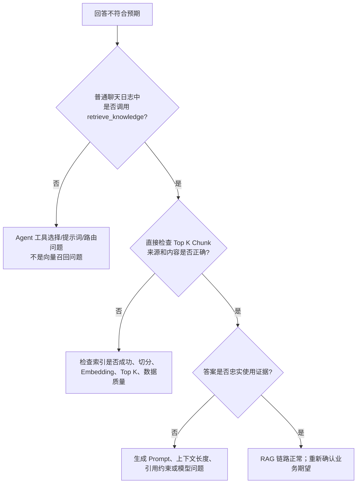

# 当前项目 RAG 深度学习：从上传文档到生成答案

> 本文基于当前工作区代码梳理，代码位置均以本文编写时的行号为准。阅读主线是：先理解 RAG 的通用思想，再分别跟踪“建库”和“问答”两条实际调用链，最后理解项目目前能做什么、还没有做什么。

## 1. 先用一句话理解 RAG

RAG（Retrieval-Augmented Generation，检索增强生成）可以理解为给大模型安排了一次**开卷考试**：

```text
用户问题 → 从资料库找相关段落 → 将段落作为参考资料交给模型 → 模型组织答案
```

它解决的不是“让模型记住所有公司文档”，而是“回答当下问题前，拿到可更新的外部资料”。因此知识更新时，通常只需重新建立向量索引，不需要重新训练大模型。

一个完整 RAG 系统有两条相互衔接、但应分开排查的链路：

| 阶段 | 目标 | 当前项目中的入口 |
|---|---|---|
| 离线/写入（Indexing） | 把原始文件转为可检索的 Chunk、向量和元数据 | `POST /api/upload`，或 `POST /api/index_directory` |
| 在线/读取（Retrieval + Generation） | 用问题找回相关 Chunk，并由 LLM 基于它们回答 | `POST /api/chat`、`POST /api/chat_stream`，以及 AIOps Planner |

这里有一个很重要的判断方法：**“没有答对”不必然表示向量检索坏了。** 可能是没有检索、检索错了、检索结果被截断，或模型没有忠实使用检索结果。先确认证据有没有找对，再评价最终回答。

## 2. 关键角色：把抽象概念映射到项目代码

| 概念 | 通俗解释 | 项目实现 |
|---|---|---|
| 原始文档 | 人上传的 Markdown 或文本文件 | `uploads/`；接口只接受 `.md`、`.txt`，[`app/api/file.py:13-18`](../app/api/file.py#L13-L18) |
| Chunk（分片） | 将长文切成便于检索的“资料卡片” | [`DocumentSplitterService`](../app/services/document_splitter_service.py#L13) |
| Metadata（元数据） | 资料卡片背面写的来源文件、标题等标签 | [`split_markdown()`](../app/services/document_splitter_service.py#L45-L77) |
| Embedding（向量化） | 把文本编码为 1024 个数字组成的“语义坐标” | [`DashScopeEmbeddings`](../app/services/vector_embedding_service.py#L12) |
| Vector Store（向量库封装） | 给 LangChain 提供统一的“存、查向量”接口 | [`VectorStoreManager`](../app/services/vector_store_manager.py#L18) |
| Milvus Collection | 真正持久化 Chunk、向量、元数据的表/集合 | `biz`，[`MilvusClientManager`](../app/core/milvus_client.py#L44) |
| Retriever（检索器） | 把自然语言问题变成向量检索请求的适配器 | [`retrieve_knowledge()`](../app/tools/knowledge_tool.py#L13-L44) |
| Tool（工具） | 供 Agent 调用的“查知识库”能力 | `retrieve_knowledge`，[`app/tools/__init__.py:7-12`](../app/tools/__init__.py#L7-L12) |
| Generator（生成器） | 读取工具返回的资料并生成自然语言回答的 LLM | `ChatQwen` + `create_agent`，[`rag_agent_service.py:95-100`](../app/services/rag_agent_service.py#L95-L100)、[`143-147`](../app/services/rag_agent_service.py#L143-L147) |

## 3. 启动时先准备什么

应用启动时会连接 Milvus：[`app/main.py:19-41`](../app/main.py#L19-L41)。但 `VectorStoreManager` 是模块级单例，导入时就会初始化；它也会先调用 `milvus_manager.connect()`，避免 LangChain 在未建立连接时访问 Collection：[`app/services/vector_store_manager.py:21-52`](../app/services/vector_store_manager.py#L21-L52)。

Milvus 中使用固定名称为 `biz` 的 Collection，字段结构如下：

| 字段 | 类型 | 含义 |
|---|---|---|
| `id` | `VARCHAR` 主键 | 每个 Chunk 的 UUID |
| `vector` | `FLOAT_VECTOR(1024)` | Chunk 的语义向量 |
| `content` | `VARCHAR` | Chunk 原文 |
| `metadata` | `JSON` | 文件来源、标题层级等信息 |

Schema 的定义在 [`app/core/milvus_client.py:149-190`](../app/core/milvus_client.py#L149-L190)。向量索引是 `IVF_FLAT`，距离度量为 `L2`，`nlist=128`：[`app/core/milvus_client.py:192-208`](../app/core/milvus_client.py#L192-L208)。L2 是“距离”而非“相似度”：数值越小，两个向量通常越接近。

> 注意：若已存在的 `biz.vector` 维度不是 1024，启动连接代码会删除整个 Collection 并重建，见 [`app/core/milvus_client.py:102-121`](../app/core/milvus_client.py#L102-L121)。这是开发环境方便、生产环境危险的行为，因为它会丢失已有知识库。

## 4. 调用链一：文档如何进入知识库（索引链路）

下面这张图展示从上传到可检索数据的实际调用关系。方框内标出了核心代码位置。



### 4.1 上传不是建库成功的同义词

上传接口在保存文件后会同步调用 `index_single_file()`：[`app/api/file.py:70-74`](../app/api/file.py#L70-L74)。不过该调用失败时只记日志，接口仍然会以 `200 success` 返回：[`app/api/file.py:75-90`](../app/api/file.py#L75-L90)。

因此出现“文件已经在 `uploads`，问答却查不到”的第一件事不是调 Prompt，而是检查索引日志/Collection：文件保存成功与向量写入成功是两个独立结果。

批量建库的另一个入口是 `POST /api/index_directory`，最终只扫描目标目录的第一层 `.txt` 和 `.md` 文件（不递归子目录）：[`app/services/vector_index_service.py:67-122`](../app/services/vector_index_service.py#L67-L122)。默认目录是 `./uploads`，所以仓库里的 `aiops-docs/` 内容**不会因为启动应用自动入库**，必须显式传入该目录或通过上传进入 `uploads`。

### 4.2 为什么一定要切 Chunk

整篇故障手册直接生成一个向量，会像把一本书压缩成一个关键词：模型只能知道“大概主题”，难以找到某一条操作步骤。项目检索的最小单元是 LangChain 的 `Document(page_content, metadata)`。

Markdown 的切分策略分三步：

1. 先按一级、二级标题切分，保留标题原文；对应 [`document_splitter_service.py:21-29`](../app/services/document_splitter_service.py#L21-L29)、[`62-63`](../app/services/document_splitter_service.py#L62-L63)。这让“磁盘满了”优先命中对应章节而不是整篇手册。
2. 再用 `RecursiveCharacterTextSplitter` 切过长的段落；对应 [`31-37`](../app/services/document_splitter_service.py#L31-L37)、[`64-65`](../app/services/document_splitter_service.py#L64-L65)。
3. 最后尝试把小于 300 字符的片段合并，减少“只有半句话”的碎片；对应 [`67-68`](../app/services/document_splitter_service.py#L67-L68)、[`134-172`](../app/services/document_splitter_service.py#L134-L172)。

配置里的 `chunk_max_size=800`、`chunk_overlap=100` 在 [`app/config.py:41-43`](../app/config.py#L41-L43)，但二次切分实际传入的是 `chunk_size * 2`，也就是目标约 **1600 字符**，而不是 800：[`document_splitter_service.py:31-36`](../app/services/document_splitter_service.py#L31-L36)。这里的“字符”不是 Token；中文、英文、代码的 Token 数不同，最终 Prompt 占用应另行观测。

### 4.3 Metadata 为什么不可省略

每个 Markdown Chunk 会带上：

```text
_source      规范化后的完整文件路径（用于更新时删除旧数据）
_extension   扩展名
_file_name   文件名（用于展示来源）
h1 / h2      标题切分器保留的层级信息（若存在）
```

这相当于图书馆书签。没有它，虽然仍能按语义找文本，却无法可靠显示出处、按文件更新或后续增加“只查某个系统/租户”的过滤。当前覆盖上传时，通过 `metadata["_source"] == 文件路径` 删除同源 Chunk：[`app/services/vector_store_manager.py:105-116`](../app/services/vector_store_manager.py#L105-L116)。

### 4.4 Embedding 和写入发生在哪里

`add_documents()` 没有显式写出逐条向量化循环，是因为 `langchain_milvus.Milvus.add_documents()` 会调用构造时传入的 `embedding_function`：[`app/services/vector_store_manager.py:40-52`](../app/services/vector_store_manager.py#L40-L52)、[`78-83`](../app/services/vector_store_manager.py#L78-L83)。具体实现 `embed_documents()` 用 DashScope OpenAI 兼容接口批量请求 `text-embedding-v4`，维度固定 1024：[`app/services/vector_embedding_service.py:58-85`](../app/services/vector_embedding_service.py#L58-L85)、[`124-128`](../app/services/vector_embedding_service.py#L124-L128)。

可以把 Embedding 看作坐标转换：

```text
“CPU 使用率持续很高” → [0.021, -0.18, ..., 0.07]  （1024 个浮点数）
```

文档与问题必须使用兼容的同一嵌入模型和维度，才有可比较的“坐标系”。更换模型或维度后，应重建索引；不能把新问题向量拿去匹配旧模型的文档向量。

## 5. 调用链二：提问时 RAG 如何发生（查询与生成链路）

普通对话从 `/api/chat` 或 `/api/chat_stream` 进入。重点是：知识检索器被注册成 Agent 工具，**是否调用由模型在当轮决定**，并非所有问题都会查库。



### 5.1 Agent 如何拿到“查知识库”能力

`retrieve_knowledge`、时间查询、Prometheus 告警查询组成默认本地工具集：[`app/tools/__init__.py:7-12`](../app/tools/__init__.py#L7-L12)。`RagAgentService` 创建 `ChatQwen`，收集本地及 MCP 工具，并交给 LangGraph 的 `create_agent()`：[`app/services/rag_agent_service.py:95-113`](../app/services/rag_agent_service.py#L95-L113)、[`117-154`](../app/services/rag_agent_service.py#L117-L154)。

之后 `query()` 通过 `agent.ainvoke()` 获取完整答案：[`app/services/rag_agent_service.py:202-239`](../app/services/rag_agent_service.py#L202-L239)；`query_stream()` 通过 `agent.astream(..., stream_mode="messages")` 获取增量输出：[`app/services/rag_agent_service.py:269-323`](../app/services/rag_agent_service.py#L269-L323)。`session_id` 被作为 LangGraph `thread_id`，由进程内 `MemorySaver` 保存会话状态：[`app/services/rag_agent_service.py:108-109`](../app/services/rag_agent_service.py#L108-L109)、[`215-220`](../app/services/rag_agent_service.py#L215-L220)。这属于对话记忆，不等于知识库。

### 5.2 检索器内部到底做了什么

知识工具的实现很短，但完成了 RAG 的检索核心：

```python
vector_store = vector_store_manager.get_vector_store()
retriever = vector_store.as_retriever(search_kwargs={"k": config.rag_top_k})
docs = retriever.invoke(query)
context = format_docs(docs)
```

对应 [`app/tools/knowledge_tool.py:26-44`](../app/tools/knowledge_tool.py#L26-L44)。`RAG_TOP_K` 默认是 3：[`app/config.py:37-39`](../app/config.py#L37-L39)。在 LangChain 的 VectorStore 封装内部，检索器会用同一个 `embedding_function` 调用 `embed_query()`（实现见 [`app/services/vector_embedding_service.py:91-121`](../app/services/vector_embedding_service.py#L91-L121)），把问题变成向量，再向 Milvus 请求最近的 K 个 Chunk。

工具随后把每个 Document 格式化为类似下面的文本：

```text
【参考资料 1】
标题: 磁盘故障 > 清理步骤
来源: disk_high_usage.md
内容:
...
```

格式化逻辑在 [`app/tools/knowledge_tool.py:51-85`](../app/tools/knowledge_tool.py#L51-L85)。工具声明了 `response_format="content_and_artifact"`：格式化文本是 Agent 可读取的上下文，原始 `Document` 列表则作为 artifact 一并返回给框架：[`app/tools/knowledge_tool.py:13-24`](../app/tools/knowledge_tool.py#L13-L24)。

### 5.3 为什么普通聊天有时完全不检索

这是当前设计最容易误解的一点：`create_agent` 给模型的是“工具说明和调用能力”，不是“每次必走的固定 RAG Pipeline”。系统提示词只要求模型在需要专业知识时主动选择合适工具：[`app/services/rag_agent_service.py:156-184`](../app/services/rag_agent_service.py#L156-L184)。所以它可能：

- 直接回答常识性问候；
- 调用时间、Prometheus 或 MCP 工具，而不调用知识库；
- 因模型判断偏差，即使问题本应查文档也没有调用 `retrieve_knowledge`。

排查“没引用资料”的顺序应是：先看日志中有没有“知识检索工具被调用”（该日志在 [`knowledge_tool.py:26`](../app/tools/knowledge_tool.py#L26)），再看 Top K Chunk 是否正确，最后看最终答案是否使用了这些 Chunk。

## 6. AIOps 中的 RAG：与普通聊天不同的触发方式

AIOps 的 Planner 为了在制定排障计划前获取历史经验，直接执行：

```python
context_str = await retrieve_knowledge.ainvoke({"query": input_text})
```

见 [`app/agent/aiops/planner.py:77-90`](../app/agent/aiops/planner.py#L77-L90)。随后将检索到的资料嵌进 Planner Prompt，再生成结构化的 `Plan`：[`app/agent/aiops/planner.py:107-135`](../app/agent/aiops/planner.py#L107-L135)。

| 场景 | 谁触发检索 | 是否每轮必检索 |
|---|---|---|
| 普通 `/api/chat`、`/api/chat_stream` | LLM/Agent 自主 tool call | 否 |
| AIOps Planner | 业务代码显式 `retrieve_knowledge.ainvoke()` | 是（调用异常时降级为空资料） |

这也是为什么 AIOps 的“经验文档参与度”更稳定，而聊天 RAG 的灵活性更高。若产品要求“凡涉及内部知识的问题都必须查库”，普通聊天应改造成显式检索链，或增加可靠的路由/强制工具策略，而不是仅依赖模型自觉。

## 7. 项目里还有一个原生检索服务：它不在主问答链路上

[`app/services/vector_search_service.py`](../app/services/vector_search_service.py) 使用 PyMilvus `Collection.search()` 自己完成“问题向量化 → 搜索 → 解析距离”，并显式设置 `nprobe=10`：[`vector_search_service.py:44-100`](../app/services/vector_search_service.py#L44-L100)。

它适合调试或未来做独立检索 API，但当前 `retrieve_knowledge` 使用的是 `langchain_milvus.Milvus.as_retriever()`，不是这个 `VectorSearchService`。因此：

- 不要把该文件中的 `score=hit.distance` 当成聊天 RAG 已返回给模型的分数；主链路没有暴露分数。
- `nprobe=10` 仅在这个原生服务中明确设置；不要据此断言 LangChain 主链路一定使用同一检索参数。
- 若要评测召回质量，优先直接调用 `retrieve_knowledge` 或专门暴露并统一一个可观测的检索服务，避免两条路径参数不同造成误判。

## 8. 当前实现的能力边界与学习重点

### 已实现

- `.md` / `.txt` 上传、覆盖更新与目录批量索引；
- Markdown 标题感知切分、递归切分、少量小片段合并；
- DashScope `text-embedding-v4` 的 1024 维文档/查询向量；
- Milvus 向量检索，默认取 Top 3；
- 将标题、文件来源、正文格式化为工具上下文；
- 对话 Agent 的可选检索，以及 AIOps Planner 的主动检索。

### 尚未实现或未接入主链路

- **重排序（Rerank）**：没有先召回较多候选再用 reranker 精排的步骤；当前就是向量 Top K 直接进模型。
- **混合检索**：没有关键词/BM25 与向量检索融合；对精确错误码、命令、ID 的召回可能不够稳。
- **相关性阈值**：即便 Top 3 距离很远，当前工具也会将其作为“参考资料”返回；没有“低于阈值则无资料”的守门逻辑。
- **强制引用/答案约束**：格式化文本带了来源，但 Prompt 没要求逐条引用，接口也没有将 artifact 或检索分数返回前端。
- **检索可观测性**：聊天 SSE 代码能处理 `tool_call`、`search_results` 类型事件，[`app/api/chat.py:101-156`](../app/api/chat.py#L101-L156)，但当前 `query_stream()` 实际只产出 `content`、`complete`、`error`，[`rag_agent_service.py:297-330`](../app/services/rag_agent_service.py#L297-L330)。因此前端不会天然获得 RAG 命中详情。
- **持久化会话记忆**：`MemorySaver` 是进程内内存，重启应用后会话历史消失；这与 Milvus 知识库持久化是两件事。

## 9. 推荐的调试路径：把问题定位在正确环节



建议先绕开 Agent，单独验证检索：

```python
from app.tools.knowledge_tool import retrieve_knowledge

result = retrieve_knowledge.invoke({"query": "磁盘使用率过高如何处理？"})
print(result)
```

这样先回答“资料卡片是否找对”，再调用聊天接口回答“模型是否正确使用资料”。不要只盯着最终自然语言答案调参。

还可构造一个很小的评测集，每个问题记录期望来源和必须出现的事实：

```json
{
  "question": "磁盘占用过高如何处理？",
  "expected_sources": ["disk_high_usage.md"],
  "expected_facts": ["检查大文件", "清理日志"]
}
```

主要观测指标：

- **Recall@K**：正确资料是否出现在前 K 个；
- **MRR**：正确资料排得是否足够靠前；
- **Faithfulness**：回答中的结论能否由召回资料支持；
- **No-answer accuracy**：没有资料时是否诚实说明“未找到”，而不是编造。

## 10. 用本项目复盘 RAG 的最短路径

1. 选一篇 `uploads/` 下的 Markdown，阅读 [`split_document()`](../app/services/document_splitter_service.py#L118-L132) 的结果，确认标题、大小、来源元数据是否合理。
2. 对同一个问题直接调用 `retrieve_knowledge`，检查前三个 Chunk；这一步只验证 Retrieval。
3. 调用 `/api/chat_stream`，查看日志是否出现知识工具调用；这一步验证 Agent 是否触发 RAG。
4. 将最终回答逐项对照 Chunk 内容；这一步验证 Generation 的忠实性。
5. 分别把 `RAG_TOP_K` 调成 1、3、5，记录正确来源排名与传入模型的文本长度，再决定是否需要增加 Rerank 或阈值。

掌握这两条调用链后，可以用一个稳定的心智模型理解项目：**Milvus 负责记住资料卡片，Embedding 负责按语义找卡片，`retrieve_knowledge` 负责把卡片整理给 Agent，LLM 最后负责把卡片讲成人能读懂的回答。**
