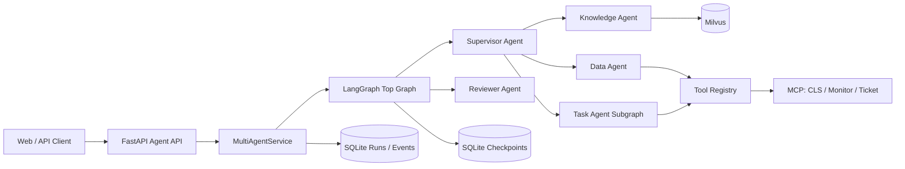

# 多智能体平台实际架构（M5）

本文只描述当前代码已经实现的能力。SQLite 是本地单实例持久化方案，不宣称生产级高可用。

边界如下：Supervisor 和 Reviewer 不持有底层业务工具；Knowledge 只使用知识检索；Data
只执行 Registry 授权的只读工具；Task 负责有依赖的 Plan-Execute-Replan 子图。顶层图限制
Supervisor 轮次、Reviewer 返工次数和图递归，所有路径结束为 `completed`、`partial` 或
`failed`。

运行记录表保存公开响应、安全事件和耗时统计。LangGraph 自身的 Checkpoint 与公共运行索引
共用数据库文件但使用独立表。隐藏思维链、密钥、Authorization Header 和未限制的工具原始
返回值不进入公共 trace。

