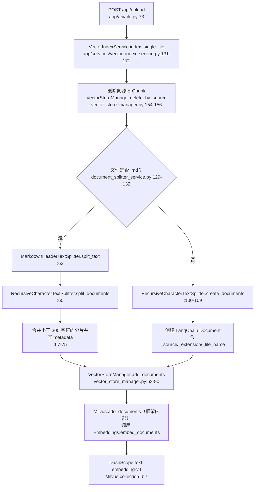
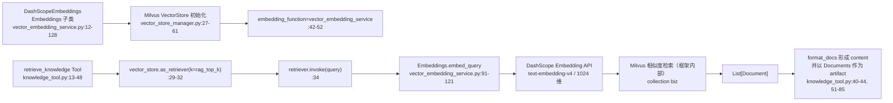
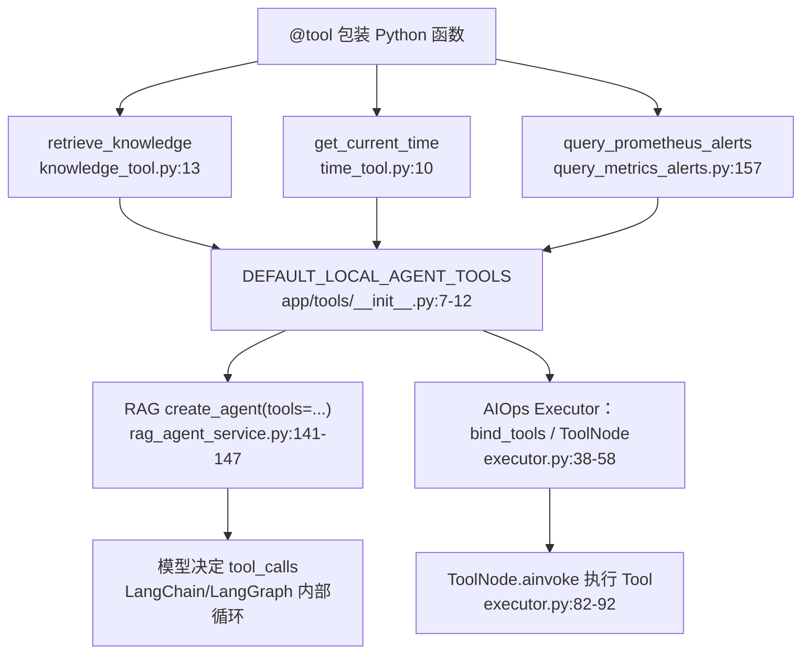
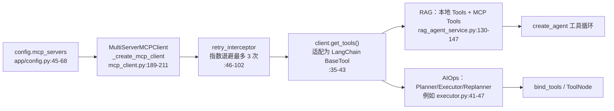
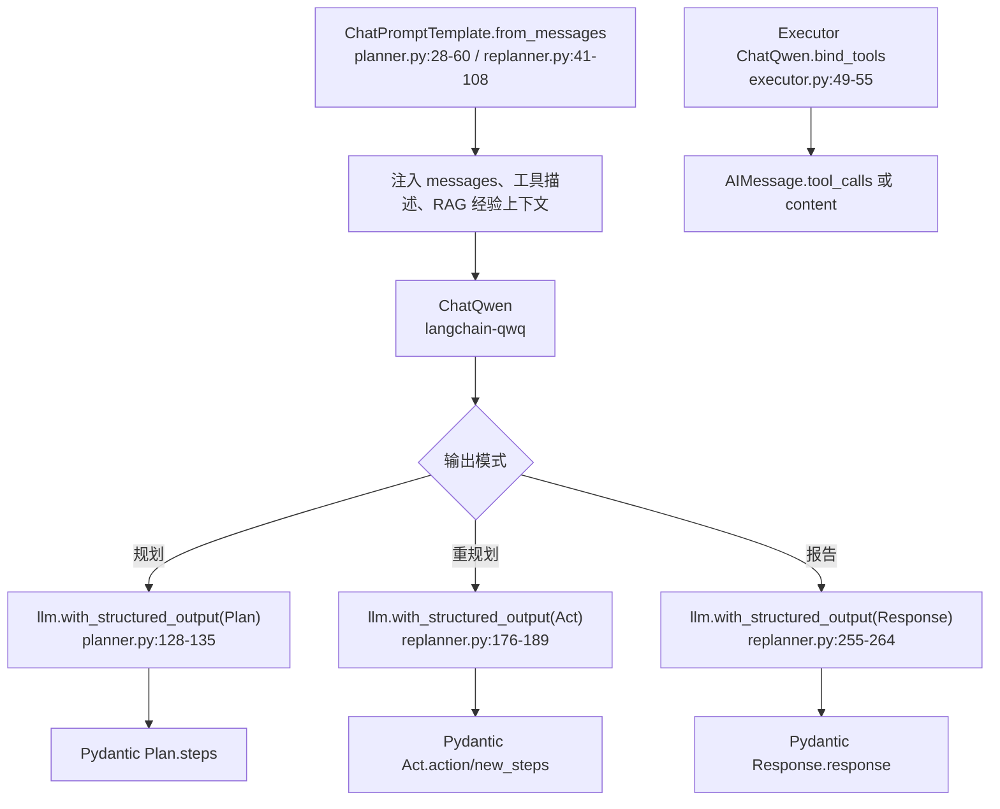
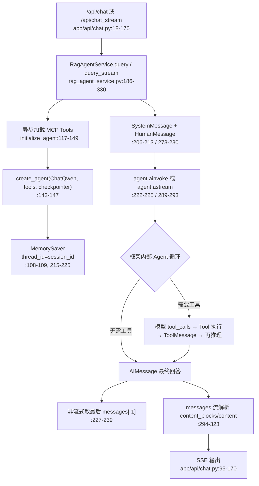
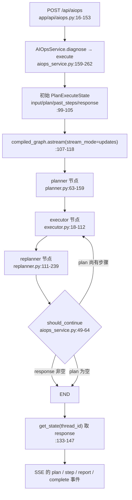
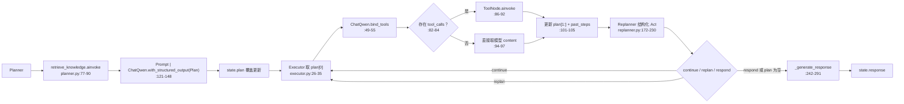

# 当前项目 LangChain / LangGraph 功能模块与调用流程

> 代码基线：本仓库当前工作区；定位格式为 `文件:行号`。本文只记录**源码中实际定义或接入的框架能力**，并对“已定义但未进入主调用链”的项单独标注。Mermaid 图中的“框架内部”表示调用由 LangChain/LangGraph 实现，不是本仓库可继续追踪的 Python 函数。

## 1. 功能全景与模块边界

| 模块 | 框架能力 | 项目落点 | 是否在主链路中运行 |
| --- | --- | --- | --- |
| A | `Document`、Markdown/递归文本切分 | `document_splitter_service.py` | 是，上传/目录索引时 |
| B | `Embeddings`、Milvus `VectorStore` | `vector_embedding_service.py`、`vector_store_manager.py` | 是，索引与检索时 |
| C | `@tool`、Retriever | `app/tools/*.py` | 是，供两个 Agent 使用 |
| D | MCP 到 `BaseTool` 的适配与拦截器 | `app/agent/mcp_client.py` | 是，MCP 服务可用时 |
| E | `ChatQwen`、消息、Prompt、Runnable、结构化输出 | RAG 与 AIOps 节点 | 是 |
| F | `create_agent()`、消息状态、Checkpoint、流式消息 | `rag_agent_service.py` | 是，对话主链路 |
| G | `StateGraph`、节点/边、条件路由、状态 Reducer、`ToolNode` | `aiops_service.py`、`app/agent/aiops/` | 是，AIOps 主链路 |

依赖锁定版本可由 `uv.lock` 确认：LangChain 1.2.10、LangGraph 1.0.8、`langchain-qwq` 0.3.4、`langchain-milvus` 0.3.3、`langchain-mcp-adapters` 0.2.1、`langchain-text-splitters` 1.1.0。不要把 `pyproject.toml` 中的 `>=` 最低版本当作运行版本。

---

## A. RAG 文档处理与入库

### 流程图

### 步骤说明

1. 文件 API 调用 `VectorIndexService.index_single_file()`；上传路径入口在 `app/api/file.py:73`，目录批量入口在 `app/api/file.py:100-115`，单文件处理实现在 `app/services/vector_index_service.py:131-171`。
2. 为避免同一个文件重复入库，先以 `metadata["_source"]` 删除旧向量，见 `app/services/vector_index_service.py:154-156` 与 `app/services/vector_store_manager.py:95-121`。
3. `DocumentSplitterService.split_document()` 以扩展名选择切分器：Markdown 走两阶段切分，其他文本直接走递归字符切分，见 `app/services/document_splitter_service.py:118-132`。
4. Markdown 首先用 LangChain `MarkdownHeaderTextSplitter` 按 `#` / `##` 保留结构切分（`app/services/document_splitter_service.py:21-29, 62`），再用 `RecursiveCharacterTextSplitter` 按 `chunk_max_size * 2` 与重叠长度细分（`:31-37, 65`）。默认配置 `chunk_max_size=800`、`chunk_overlap=100` 在 `app/config.py:41-43`，故二次切分目标是 1600 字符。
5. 小于 300 字符的片段会按条件并入前一个片段，并给每个最终 `Document` 写入来源、扩展名和文件名元数据（`app/services/document_splitter_service.py:67-75, 134-172`）。普通文本通过 `create_documents()` 创建同一类型的 LangChain `Document`（`:100-109`）。
6. `VectorStoreManager.add_documents()` 生成 UUID 后调用 `Milvus.add_documents()`（`app/services/vector_store_manager.py:63-90`）。后者是 `langchain-milvus` 的框架实现，会批量调用传入的 `embedding_function.embed_documents()`；项目没有手写逐条向量循环。

---

## B. Embeddings、VectorStore 与 Retriever 检索

### 流程图

### 步骤说明

1. `DashScopeEmbeddings` 继承 LangChain `Embeddings` 协议，实现写入所需的 `embed_documents()` 和查询所需的 `embed_query()`，精确位置为 `app/services/vector_embedding_service.py:12-18, 58-121`。两者实际经 OpenAI 兼容接口调用 DashScope，维度固定为 1024（`:37-42, 75-80, 107-112`）。
2. 模块级 `vector_store_manager` 在导入时初始化（`app/services/vector_store_manager.py:152-153`）。它先显式建立 PyMilvus 连接，再创建 `langchain_milvus.Milvus`，并将文本、向量、主键、元数据分别映射到 `content`、`vector`、`id`、`metadata` 字段（`:27-52`）。
3. `retrieve_knowledge` 创建 Retriever 时传入 `k=config.rag_top_k`（`app/tools/knowledge_tool.py:29-34`）；当前默认 Top-K 是 3，见 `app/config.py:37-39`。`as_retriever()` 和 `invoke()` 是 LangChain 统一检索接口。
4. Retriever 内部会调用本项目实现的 `embed_query()`，将问题向量化后在 Milvus 中查最近文档；项目获得 `List[Document]` 后由 `format_docs()` 将页内容、文件名和标题元数据组合为模型可读上下文（`app/tools/knowledge_tool.py:40-44, 51-85`）。
5. 该 Tool 使用 `response_format="content_and_artifact"`：格式化字符串是给模型的 content，原始 `Document` 列表是 artifact（`app/tools/knowledge_tool.py:13-14, 44`）。在 Planner 中通过 Tool 的 `ainvoke()` 调用时，代码按注释只读取 content（`app/agent/aiops/planner.py:81-85`）。

**补充：** `VectorStoreManager.similarity_search()` 也封装了直接检索（`app/services/vector_store_manager.py:132-149`），但主知识工具并未调用它，而是使用 `as_retriever().invoke()`。`vector_search_service.py` 是 PyMilvus 原生搜索分支，也不属于 LangChain 主 RAG 调用链。

---

## C. LangChain Tool：本地工具的声明、注册与调用

### 流程图

### 步骤说明

1. `@tool` 将普通函数转为可向模型公开名称、参数 schema 与 docstring 的 LangChain Tool。三项本地工具分别是知识检索、时区时间、Prometheus 活动告警，定义位置为 `app/tools/knowledge_tool.py:13-48`、`app/tools/time_tool.py:10-32`、`app/tools/query_metrics_alerts.py:157-202`。
2. `DEFAULT_LOCAL_AGENT_TOOLS` 将三项工具集中注册（`app/tools/__init__.py:7-12`），RAG Agent 初始化时复制该集合（`app/services/rag_agent_service.py:102-103`）；AIOps 的 Planner、Executor、Replanner 同样以它为本地工具基线（如 `app/agent/aiops/executor.py:38-47`）。
3. Tool 的 docstring 不是纯注释：LangChain 会将其与参数 schema 提供给模型，供模型决定是否返回 `tool_calls`。因此 `retrieve_knowledge` 的“何时使用”描述在 `app/tools/knowledge_tool.py:15-23`，时间工具的描述在 `app/tools/time_tool.py:12-20`，会直接影响模型选工具。
4. RAG Agent 把 Tool 列表传给 `create_agent()`，其内置 Agent 循环负责处理模型 tool call、执行 Tool、写回 ToolMessage 并继续推理；项目调用入口为 `app/services/rag_agent_service.py:143-147, 222-225`。
5. AIOps Executor 不使用封装 Agent 循环，而是显式 `llm.bind_tools(all_tools)`，检查 `llm_response.tool_calls` 后交由 LangGraph `ToolNode` 执行（`app/agent/aiops/executor.py:49-58, 78-104`）。这两种调用形式的控制权不同，但工具定义复用相同。

---

## D. MCP 工具适配与重试拦截

### 流程图

### 步骤说明

1. `config.mcp_servers` 生成 CLS 和监控 MCP 服务的 transport / URL 配置（`app/config.py:45-68`）。`get_mcp_client()` 以模块级单例维护 `MultiServerMCPClient`（`app/agent/mcp_client.py:16-17, 112-155`）。
2. `get_mcp_client_with_retry()` 将 `retry_interceptor` 注入客户端（`app/agent/mcp_client.py:158-186`）。拦截器围绕一次 MCP 工具调用执行，失败时按 1、2、4 秒重试，最终返回 `isError=True` 的 MCP 结果而非继续抛异常（`:46-102`）。
3. `client.get_tools()` 由 `langchain-mcp-adapters` 把远端 MCP 描述适配为可同本地 `@tool` 一起使用的 `BaseTool`；安全加载封装在 `load_mcp_tools_safe()`（`:35-43`）。
4. RAG 初始化中 MCP 加载失败只记录警告并退化为本地工具（`app/services/rag_agent_service.py:130-141`）。AIOps 节点则直接 `get_tools()`；该异常由各节点自己的 `try/except` 处理（Planner `app/agent/aiops/planner.py:92-105`，Executor `app/agent/aiops/executor.py:41-47`）。

---

## E. LangChain 模型、消息、Prompt、Runnable 与结构化输出

### 流程图

### 步骤说明

1. RAG 对话服务直接创建 `ChatQwen(streaming=...)`，并用 `SystemMessage` 与 `HumanMessage` 作为输入，见 `app/services/rag_agent_service.py:95-100, 206-225`。消息对象是 LangChain 统一消息协议。
2. Planner 与 Replanner 使用 `ChatPromptTemplate.from_messages()` 声明系统模板和 `{messages}` 占位符（`app/agent/aiops/planner.py:28-60`、`app/agent/aiops/replanner.py:41-108`）。`|` 将 Prompt 与模型串成 Runnable Chain；异步统一以 `ainvoke()` 执行。
3. `with_structured_output(PydanticModel)` 要求模型输出可解析对象，而不是自由文本：计划对应 `Plan.steps`（`planner.py:20-24, 128-142`），决策对应 `Act.action/new_steps`（`replanner.py:25-37, 176-199`），最终报告对应 `Response.response`（`replanner.py:20-22, 255-271`）。
4. Executor 改为 `bind_tools(all_tools)`，因此模型可返回 `AIMessage.tool_calls`；若无调用，直接读取 `content`，否则进入 ToolNode 后再调用一次模型生成答案（`app/agent/aiops/executor.py:49-97`）。

**已定义但当前未接入：** `app/core/llm_factory.py:18-52` 定义了基于 `langchain_openai.ChatOpenAI` 的工厂；仓库内没有 `LLMFactory` 或 `llm_factory` 的其他引用。因此它是可用的框架封装，不是当前 RAG/AIOps 的运行模型路径（两条主链路均使用 `ChatQwen`）。

---

## F. 封装式 LangGraph Agent：RAG 对话、记忆与消息流

### 流程图

### 步骤说明

1. HTTP 对话接口将 question 和 request ID 传给 `RagAgentService`；普通响应入口在 `app/api/chat.py:18-66`，SSE 入口在 `:69-170`。
2. 首次请求执行 `_initialize_agent()`，将本地与 MCP Tool 合并后创建 `create_agent(model, tools, checkpointer)`（`app/services/rag_agent_service.py:117-149`）。这是 LangChain 提供的预构建 Agent；底层使用 LangGraph 运行有状态的模型/工具循环。
3. `MemorySaver` 被传给 Agent（`app/services/rag_agent_service.py:108-109, 143-147`）；每次执行的 `session_id` 被放入 `configurable.thread_id`（`:215-225, 282-293`）。所以相同 session 会关联同一进程内的 checkpoint；它是对话记忆，**不是** Milvus RAG 知识库。
4. `AgentState.messages` 用 `add_messages` Reducer 定义了追加式消息字段（`app/services/rag_agent_service.py:36-39`）。`query()` 将系统提示和用户消息提交给 `agent.ainvoke()`，结果从最终 `messages[-1]` 读取（`:206-239`）。
5. 流式模式调用 `agent.astream(stream_mode="messages")`（`:289-293`）；每个 token 的 metadata 中可取 `langgraph_node`，并兼容 `content_blocks` 与 `content` 两种增量格式，最后映射为 SSE 事件（`:294-323`，`app/api/chat.py:130-147`）。
6. 会话历史从 checkpointer 的 `channel_values.messages` 读取，清理时调用 `delete_thread(session_id)`，见 `app/services/rag_agent_service.py:332-416`。

**已定义但当前未注册：** `trim_messages_middleware()` 实现了“系统消息 + 最近 6/7 条消息”的裁剪逻辑（`app/services/rag_agent_service.py:41-78`），但 `create_agent()` 调用处 `:143-147` 没有传入该 middleware，且仓库内没有其他调用。因此当前运行的会话并不会执行此裁剪。

---

## G. 显式 LangGraph：AIOps Plan–Execute–Replan

### 流程图

### 图构建与状态语义

1. `PlanExecuteState` 是图的共享 State：`input` 为原始任务、`plan` 为剩余步骤、`response` 为最终报告；`past_steps` 注解为 `Annotated[List[tuple], operator.add]`，因此节点返回的历史会**追加**而不是覆盖（`app/agent/aiops/state.py:10-24`）。其他无 Reducer 的字段是节点返回值覆盖当前值的语义。
2. `AIOpsService._build_graph()` 以该 State 创建 `StateGraph`，注册 planner、executor、replanner 三个节点，设置 planner 为入口，并添加两条固定边（`app/services/aiops_service.py:29-46`）。
3. Replanner 后的条件边由 `should_continue()` 决定：有 `response` 则结束；仍有 `plan` 则回到 executor；空计划则结束（`app/services/aiops_service.py:48-73`）。编译时把 `MemorySaver` 绑定到图（`:75-79`）。
4. `execute()` 初始化 State、设置 `thread_id`，通过 `graph.astream(..., stream_mode="updates")` 按节点状态增量产生事件；结束后用 `get_state()` 读取 checkpoint 中的最终 `response`（`app/services/aiops_service.py:81-147`）。

### 节点内调用流程

### 步骤说明

1. Planner 先直接调用 `retrieve_knowledge.ainvoke()` 获取经验文档（`app/agent/aiops/planner.py:77-90`），再收集本地/MCP 工具描述（`:92-105`），将 Prompt 与 `ChatQwen.with_structured_output(Plan)` 组成 Runnable，输出 `plan` 更新（`:121-148`）。这使 RAG 在 AIOps 中是**规划前置检索**，与对话 Agent 中“由模型自行决定是否调知识工具”不同。
2. Executor 一次仅处理 `plan[0]`，把工具绑定到 `ChatQwen`（`app/agent/aiops/executor.py:26-58`）。模型有 `tool_calls` 时，`ToolNode` 根据调用名和参数自动调工具；工具结果消息被追加后再次调用绑定工具的模型生成此步结论（`:78-97`）。节点返回新的剩余计划和一个 `(task, result)`，Reducer 会把后者追加至 `past_steps`（`:101-105`）。
3. Replanner 读取已执行与剩余步骤，以结构化 `Act` 决策 `continue`、`replan` 或 `respond`（`app/agent/aiops/replanner.py:172-230`）。它还设置最大 8 步的硬上限，超过即生成结果（`:129-138`）；重新规划会替换而非追加剩余 `plan`（`:206-226`）。
4. 需要结束时 `_generate_response()` 将原始任务与 `past_steps` 注入 `response_prompt | llm.with_structured_output(Response)`，将报告写进 State 的 `response`（`app/agent/aiops/replanner.py:242-291`）；条件边下一轮读取该字段并转到 `END`。

---

## 结论：两种编排方式的实际分工

| 场景 | 使用方式 | 谁控制工具循环 | 状态与流式输出 |
| --- | --- | --- | --- |
| 通用 RAG 对话 | `langchain.agents.create_agent()` | LangChain/LangGraph 预构建 Agent 内部循环 | `MemorySaver` + `thread_id`；`astream(stream_mode="messages")` |
| AIOps 诊断 | 显式 `StateGraph(PlanExecuteState)` | 项目代码：Executor 的 `bind_tools` + `ToolNode` | `MemorySaver` + `thread_id`；`astream(stream_mode="updates")` |

这两条链路共享同一套本地 Tools、MCP Tool 适配、Embedding 和 Milvus 知识库；区别在于 RAG 对话将规划/工具循环交给框架，而 AIOps 将计划、单步执行、重规划和终止条件明确写成图节点和边。
