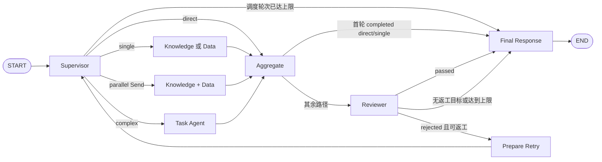
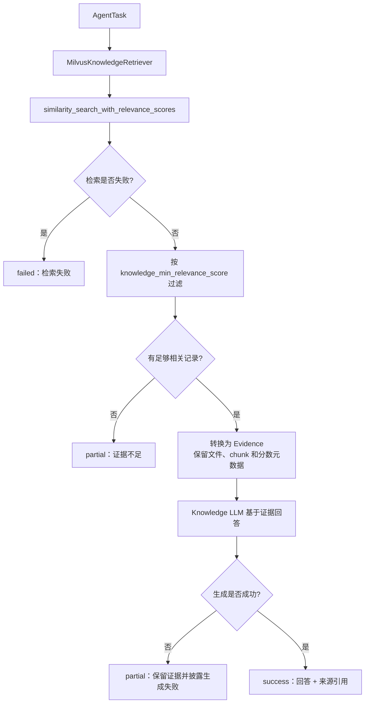
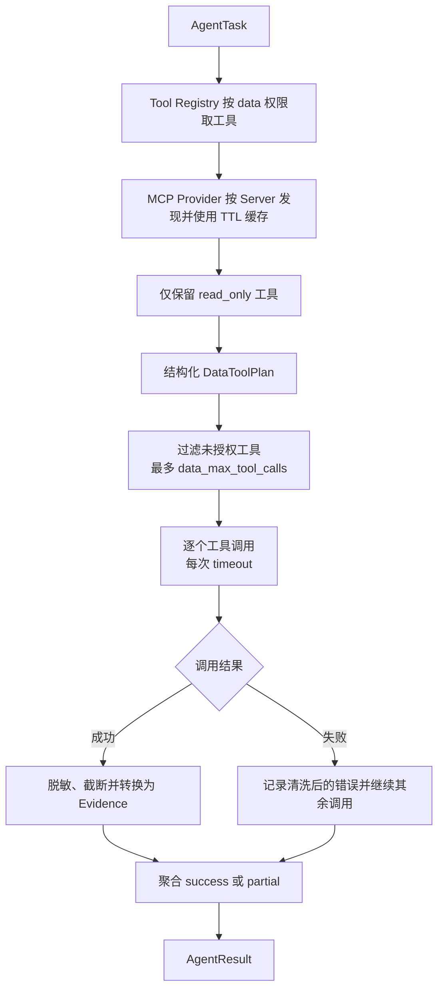
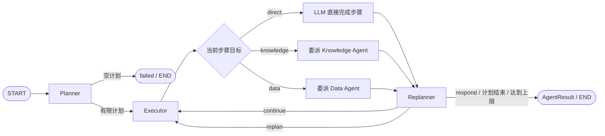
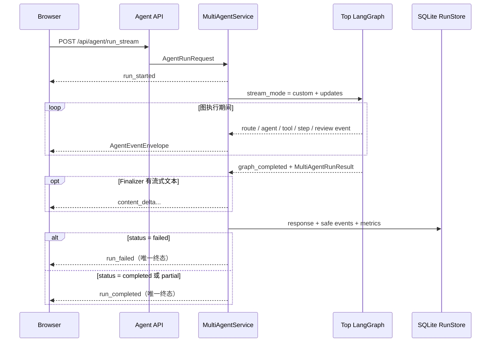
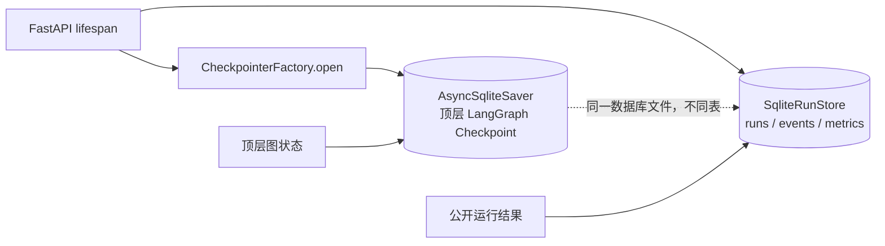
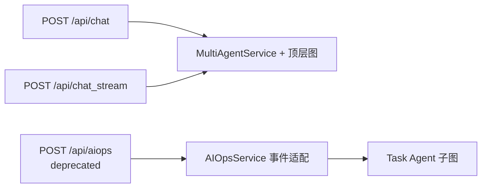

# Multi-Agent 扩展分支端到端流程链路

> 分析对象：`multi-agents` 分支，HEAD `08d5555`（M5）
>
> 对比基线：`main` 分支，HEAD `46ab4e1`
>
> 核对日期：2026-08-23
>
> 事实来源：当前源码、M1～M5 交接文档与自动化测试；规划文档中的未实现能力不计入本图。

## 1. 结论先行

当前扩展分支的主要产品链路已经从 `main` 上彼此独立的“RAG 对话 Agent”和“AIOps
Plan-Execute-Replan 工作流”，演进为统一的 Supervisor-Specialist 顶层 LangGraph：

- 浏览器或 API 调用方统一提交 `user_id`、`thread_id` 和 `message`。
- Supervisor 只做受限路由，可选择 `direct`、`single`、`parallel` 或 `complex`。
- `single` 调用 Knowledge 或 Data；`parallel` 只并发调用相互独立、只读的 Knowledge 与
  Data；`complex` 进入 Task Agent 的 Plan-Execute-Replan 子图。
- 聚合后，成功的 `direct`/`single` 走快速路径；复杂、并行或非完整结果进入 Reviewer。
- Reviewer 最多触发一次定向返工；到达上限后必须透明地以 `partial` 或 `failed` 结束。
- 最终结果被标准化、脱敏并写入运行记录；JSON 一次返回，SSE 则只发送一个终态事件。

这里真正作为协作单元的 Agent 是 Supervisor、Knowledge、Data、Task 和 Reviewer。
Task 内部的 Planner、Executor、Replanner 是子图节点，不是三个独立 Agent；MCP Server 和
Tool 也是外部能力，不是 Agent。

## 2. 从用户开始到结果结束的总链路图

```mermaid
flowchart TD
    A["用户输入问题<br/>static/app.js:670-718"] --> B{"传输方式"}
    B -->|快速 JSON| C["POST /api/agent/run<br/>static/app.js:720-752"]
    B -->|流式 SSE| D["POST /api/agent/run_stream<br/>static/app.js:762-805"]

    C --> E["Pydantic 校验 AgentRunRequest<br/>app/models/agent.py:29-50"]
    D --> E
    E --> F["FastAPI Agent API<br/>app/api/agent.py:21-45"]
    F --> G["MultiAgentService 创建 run_id<br/>区分 user_id/thread_id/run_id<br/>app/services/multi_agent_service.py:113-150"]
    G --> H["初始化 MultiAgentState<br/>Checkpoint key = thread_id:run_id<br/>app/agent/graph.py:534-566"]
    H --> I["顶层 LangGraph START → Supervisor<br/>app/agent/graph.py:118-145"]

    I --> J["Supervisor 结构化路由<br/>失败时确定性降级<br/>app/agent/supervisor/agent.py:73-147"]
    J --> K{"RouteDecision.mode<br/>direct / single / parallel / complex"}

    K -->|direct| L["不委派 Specialist<br/>直接进入聚合"]
    K -->|single: knowledge| M["Knowledge Agent"]
    K -->|single: data| N["Data Agent"]
    K -->|parallel| O["LangGraph Send 并行扇出<br/>Knowledge + Data<br/>app/agent/graph.py:180-200"]
    K -->|complex| P["Task Agent 子图"]

    O --> M
    O --> N

    M --> M1["Milvus 相似度检索 + 相关度过滤<br/>形成 Evidence 与带引用回答<br/>knowledge/retriever.py:26-35<br/>knowledge/agent.py:70-133"]
    N --> N1["Registry 获取 Data 白名单工具<br/>只读过滤 + 调用数/超时限制<br/>data/agent.py:63-141"]
    N1 --> N2["本地数据工具或 MCP 工具<br/>Registry/Provider 缓存与失败降级<br/>app/tools/registry.py:88-133<br/>app/tools/mcp_provider.py:58-113"]

    P --> P1["Planner 生成有限步骤计划<br/>task/graph.py:65-77"]
    P1 --> P2["Executor 顺序执行当前步骤<br/>可直接处理或委派 Knowledge/Data<br/>task/executor.py:37-84"]
    P2 --> P3["Replanner: continue / replan / respond<br/>task/graph.py:111-139"]
    P3 -->|继续且未超限| P2
    P3 -->|完成、失败或达到硬限制| P4["Task AgentResult<br/>success / partial / failed"]

    L --> Q["Aggregate 聚合并统一全局引用编号<br/>app/agent/graph.py:328-358, 585-607"]
    M1 --> Q
    N2 --> Q
    P4 --> Q

    Q --> R{"是否为首次执行且<br/>completed 的 direct/single?"}
    R -->|是：快速路径| U["Finalize"]
    R -->|否| S["Reviewer<br/>确定性检查 → 结构化语义审核<br/>reviewer/agent.py:73-116"]
    S --> T{"审核结果"}
    T -->|通过| U
    T -->|拒绝且仍可返工| T1["retry_count + 1<br/>prepare_retry"]
    T1 --> I
    T -->|拒绝且到达上限或无目标| U

    U --> U1{"状态允许且<br/>未审核或审核通过?"}
    U1 -->|是| U2["Final Response LLM<br/>仅整理已有事实并流式输出<br/>app/agent/final_response.py:50-79"]
    U1 -->|否| U3["保留失败/部分成功/审核问题<br/>不再补写事实"]
    U2 --> V["MultiAgentRunResult<br/>completed / partial / failed"]
    U3 --> V

    V --> W["公共响应转换、证据去重、字段白名单与脱敏<br/>multi_agent_service.py:383-487"]
    W --> X["保存 response + safe events + metrics<br/>multi_agent_service.py:270-285<br/>run_store.py:141-165"]
    X --> Y{"返回协议"}
    Y -->|JSON| Z["AgentRunResponse 返回浏览器<br/>static/app.js:742-752"]
    Y -->|SSE| AA["content_delta + 唯一终态<br/>run_completed 或 run_failed<br/>multi_agent_service.py:128-250"]
    AA --> AB["EventSourceResponse 推送；断开时关闭生成器<br/>app/api/agent.py:26-45"]
    AB --> AC["前端更新时间线、答案、来源与错误<br/>static/app.js:779-805, 823-973"]
    Z --> END1(["请求结束"])
    AC --> END1
```

### 如何阅读总图

1. **传输方式不改变业务编排。** `/run` 与 `/run_stream` 最终调用同一个
   `MultiAgentGraph`；区别只是前者在图完成后一次返回，后者把图的 custom event 转为统一
   SSE 信封并实时推送。
2. **Supervisor 不直接操作数据。** 它输出经过 `RouteDecision` 校验的有限目标和
   `AgentTask`；公共契约会拒绝非法的路由形状，例如 `parallel` 中出现 Task Agent，见
   [app/agent/contracts.py:51](/Users/heng/Desktop/master/agent_project/Oncall_agent/app/agent/contracts.py:51)。
3. **并行范围受到刻意限制。** 只有无依赖的只读 Knowledge/Data 任务能通过 `Send` 扇出；
   复杂任务中的步骤有先后依赖，因此由 Task 子图顺序执行。
4. **快速路径不会无条件调用 Reviewer。** 首轮执行成功的 `direct` 和 `single` 从 Aggregate
   直接进入 Finalize；`parallel`、`complex`、`partial`、`failed` 和返工后的结果都进入审核，
   见 [app/agent/graph.py:452](/Users/heng/Desktop/master/agent_project/Oncall_agent/app/agent/graph.py:452)。
5. **返工是有界闭环。** Reviewer 只能建议返工目标；`route_after_review()` 同时检查返工次数
   和 Supervisor 轮次。默认最多返工一次，见
   [app/config.py:68](/Users/heng/Desktop/master/agent_project/Oncall_agent/app/config.py:68) 与
   [app/agent/graph.py:462](/Users/heng/Desktop/master/agent_project/Oncall_agent/app/agent/graph.py:462)。
6. **每条公开路径都有明确终态。** Specialist 使用 `success/partial/failed`；顶层对外使用
   `completed/partial/failed`。流式接口把 `partial` 放在 `run_completed` 事件中透明表达，而
   `failed` 使用 `run_failed`。

## 3. 顶层 LangGraph 的控制流

下面这张图只保留图节点和条件边，对应源码中实际编译的拓扑。

图的节点注册与边定义位于
[app/agent/graph.py:118](/Users/heng/Desktop/master/agent_project/Oncall_agent/app/agent/graph.py:118)。
顶层状态位于
[app/agent/state.py:16](/Users/heng/Desktop/master/agent_project/Oncall_agent/app/agent/state.py:16)：

- `agent_results`、`dispatch_records`、`review_history`、`workflow_errors` 使用追加 Reducer，
  因而可以安全合并并行分支结果。
- `route_decision`、`pending_tasks`、`candidate_answer` 等字段采用覆盖语义，表示当前调度轮次
  的最新决定或聚合结果。
- `user_id` 标识用户，`thread_id` 标识公开会话，`run_id` 标识一次执行。顶层 Checkpoint
  实际使用 `thread_id:run_id`，避免同一公开线程中的多次运行互相混入，见
  [app/agent/graph.py:534](/Users/heng/Desktop/master/agent_project/Oncall_agent/app/agent/graph.py:534)。

### 四类路由的实际含义

| 路由 | 下游 | 是否并行 | 默认是否审核 | 适用请求 |
|---|---|---:|---:|---|
| `direct` | 无 Specialist | 否 | 首轮完整成功时否 | 不需要内部知识或外部数据的简单回答 |
| `single` | Knowledge 或 Data | 否 | 首轮完整成功时否 | 单一知识检索或单一外部数据查询 |
| `parallel` | Knowledge + Data | 是 | 是 | 两类只读信息彼此独立，可同时获取 |
| `complex` | Task Agent | 子图内部顺序执行 | 是 | 有步骤依赖、需要规划和重规划的任务 |

Supervisor 首选结构化 LLM 路由；模型调用失败或返回非法结构时，才按有限关键词规则降级。
相关实现见
[app/agent/supervisor/agent.py:22](/Users/heng/Desktop/master/agent_project/Oncall_agent/app/agent/supervisor/agent.py:22)
和 [app/agent/supervisor/agent.py:110](/Users/heng/Desktop/master/agent_project/Oncall_agent/app/agent/supervisor/agent.py:110)。

## 4. Specialist 子链路

### 4.1 Knowledge Agent：检索、证据与引用

检索边界在
[app/agent/specialists/knowledge/retriever.py:15](/Users/heng/Desktop/master/agent_project/Oncall_agent/app/agent/specialists/knowledge/retriever.py:15)，
Agent 状态分支在
[app/agent/specialists/knowledge/agent.py:70](/Users/heng/Desktop/master/agent_project/Oncall_agent/app/agent/specialists/knowledge/agent.py:70)。
“检索异常”和“没有足够相关结果”是两个不同状态；后者不会伪装成完整成功。

### 4.2 Data Agent：权限、MCP 与失败降级

Data Agent 的执行入口见
[app/agent/specialists/data/agent.py:63](/Users/heng/Desktop/master/agent_project/Oncall_agent/app/agent/specialists/data/agent.py:63)。
中央 Registry 只向 `data` 和兼容期 `legacy_chat` 暴露 MCP 工具，Supervisor、Reviewer、Task
本身没有底层工具权限，见
[app/tools/registry.py:88](/Users/heng/Desktop/master/agent_project/Oncall_agent/app/tools/registry.py:88)
和 [app/tools/registry.py:136](/Users/heng/Desktop/master/agent_project/Oncall_agent/app/tools/registry.py:136)。

MCP Provider 按 Server 独立发现工具。单个 Server 失败时记录为 `unavailable` 并继续保留其他
Server 的工具；所有工具名还会做重名检测，见
[app/tools/mcp_provider.py:58](/Users/heng/Desktop/master/agent_project/Oncall_agent/app/tools/mcp_provider.py:58)。
这意味着 MCP 故障不会阻止无关的 Knowledge 路径启动。

### 4.3 Task Agent：有依赖任务的顺序子图

子图拓扑位于
[app/agent/specialists/task/graph.py:46](/Users/heng/Desktop/master/agent_project/Oncall_agent/app/agent/specialists/task/graph.py:46)，
每一步的委派逻辑位于
[app/agent/specialists/task/executor.py:37](/Users/heng/Desktop/master/agent_project/Oncall_agent/app/agent/specialists/task/executor.py:37)。
`past_steps` 使用追加 Reducer，`plan` 使用替换语义；默认最大步骤数为 8，图递归限制为 50。
当步骤有成功也有失败时，Task 结果为 `partial`；达到步骤上限仍有计划未执行时同样明确标记
为 `partial`，见
[app/agent/specialists/task/graph.py:149](/Users/heng/Desktop/master/agent_project/Oncall_agent/app/agent/specialists/task/graph.py:149)。

## 5. Reviewer 与最终回答链路

Reviewer 只读取原始请求、候选答案、已有 Evidence 和已记录错误。它没有业务工具权限，也
不能自行补查或创造新证据。

审核分两层：

1. 确定性检查先识别“数字事实无证据”“知识证据没有有效引用”“已有错误未披露”等显式问题。
2. 未命中确定性问题时，才调用结构化 LLM 返回 `ReviewResult`。

代码位置为
[app/agent/specialists/reviewer/agent.py:73](/Users/heng/Desktop/master/agent_project/Oncall_agent/app/agent/specialists/reviewer/agent.py:73)。
如果审核拒绝且仍有预算，Supervisor 会把 `retry_instruction` 转为只针对 Knowledge、Data 或
Task 的新 `AgentTask`；返工后再次审核，无论是否通过都必须结束。定向返工实现见
[app/agent/supervisor/agent.py:88](/Users/heng/Desktop/master/agent_project/Oncall_agent/app/agent/supervisor/agent.py:88)。

Final Response LLM 不是新的业务 Agent。它只负责把已审核候选答案整理成可读回复，并被提示词
限制为保留已有事实、引用和错误说明。审核失败、所有 Specialist 失败或 Finalizer 自身失败时，
系统保留已有候选结果并输出 `partial/failed`，不会把失败静默改写为成功。实现见
[app/agent/graph.py:408](/Users/heng/Desktop/master/agent_project/Oncall_agent/app/agent/graph.py:408)
和 [app/agent/final_response.py:12](/Users/heng/Desktop/master/agent_project/Oncall_agent/app/agent/final_response.py:12)。

## 6. SSE、终态与前端展示

统一事件信封至少包含 `event_id`、`run_id`、`thread_id`、`type`、`timestamp` 和 `data`，
定义见 [app/models/agent.py:79](/Users/heng/Desktop/master/agent_project/Oncall_agent/app/models/agent.py:79)。
事件创建时会脱敏并限制大小，见
[app/services/event_service.py:17](/Users/heng/Desktop/master/agent_project/Oncall_agent/app/services/event_service.py:17)。

客户端断开连接后，API 在 `finally` 中关闭底层异步生成器，不继续消费图事件，见
[app/api/agent.py:26](/Users/heng/Desktop/master/agent_project/Oncall_agent/app/api/agent.py:26)。前端要求必须收到
一个终态，否则主动报告“响应流未返回终态事件”，见
[static/app.js:779](/Users/heng/Desktop/master/agent_project/Oncall_agent/static/app.js:779)。

## 7. Checkpoint、运行记录与恢复边界

应用启动时，FastAPI lifespan 打开 Checkpointer、重新编译顶层图、初始化 RunStore，然后连接
Milvus 并预热 MCP；MCP 预热失败不会阻止本地能力启动。启动入口见
[app/main.py:23](/Users/heng/Desktop/master/agent_project/Oncall_agent/app/main.py:23)。

- 默认路径为 `data/multi_agent.sqlite3`，配置见
  [app/config.py:68](/Users/heng/Desktop/master/agent_project/Oncall_agent/app/config.py:68)。
- `AsyncSqliteSaver` 的生命周期管理见
  [app/agent/runtime/checkpointer.py:28](/Users/heng/Desktop/master/agent_project/Oncall_agent/app/agent/runtime/checkpointer.py:28)。
- `SqliteRunStore` 保存公开请求消息、标准化响应、安全事件和单次指标，见
  [app/services/run_store.py:107](/Users/heng/Desktop/master/agent_project/Oncall_agent/app/services/run_store.py:107)。
- 该方案支持本地单实例重启后的 run/thread/trace 恢复，但不是多 Worker 共享的生产级持久化。
- Task Agent 子图仍使用自己的 `MemorySaver`；其最终 `AgentResult` 会进入顶层持久状态，但
  不能从 Task 的任意中间步骤跨进程断点续跑，见
  [app/agent/specialists/task/graph.py:31](/Users/heng/Desktop/master/agent_project/Oncall_agent/app/agent/specialists/task/graph.py:31)。
- `thread_id` 当前主要用于运行归组和历史查询；每个顶层 run 使用独立的
  `thread_id:run_id` Checkpoint key，因此不能把它描述为自动注入历史对话的长期记忆。

## 8. 兼容接口在新链路中的位置

扩展分支仍保留旧 API，但实际去向已经变化：

- `/api/chat` 和 `/api/chat_stream` 已把旧的 `Id/Question` 请求转换成 `AgentRunRequest`，并
  调用统一 `MultiAgentService`，见
  [app/api/chat.py:21](/Users/heng/Desktop/master/agent_project/Oncall_agent/app/api/chat.py:21) 和
  [app/api/chat.py:70](/Users/heng/Desktop/master/agent_project/Oncall_agent/app/api/chat.py:70)。
- `/api/aiops` 仍是 deprecated 兼容入口，使用固定诊断目标直接调用 Task Agent，并把新事件
  转回旧 AIOps SSE 形状；它不会先经过顶层 Supervisor，见
  [app/services/aiops_service.py:11](/Users/heng/Desktop/master/agent_project/Oncall_agent/app/services/aiops_service.py:11)。
- 因此，原 `xzh_docs/05-agent-call-chains.md` 对 `main` 时代内部实现的描述不再代表当前统一
  产品链路；它适合作为改造前基线阅读，本文件描述扩展后的真实链路。

## 9. 硬限制与明确终止条件

| 边界 | 当前默认值 | 代码位置 | 超限后的行为 |
|---|---:|---|---|
| Supervisor 调度轮次 | 4 | `app/config.py:71` | 停止委派，返回 `partial` |
| Task 最大步骤数 | 8 | `app/config.py:72` | 未完成计划返回 `partial` |
| Reviewer 返工次数 | 1 | `app/config.py:73` | 保留审核问题并结束 |
| Specialist 超时 | 90 秒 | `app/config.py:74` | 转为失败 `AgentResult` |
| 单工具超时 | 15 秒 | `app/config.py:75` | 记录错误，继续可执行调用 |
| 工具最大重试 | 3 | `app/config.py:76` | 清洗错误并停止重试 |
| Data 单任务工具调用数 | 4 | `app/config.py:77` | 截断计划中的额外调用 |
| 图递归限制 | 50 | `app/config.py:82` | 图异常被转换为 `failed` |

限制由
[app/agent/runtime/limits.py:8](/Users/heng/Desktop/master/agent_project/Oncall_agent/app/agent/runtime/limits.py:8)
统一读取和校验。Reviewer 返工值只允许为 0 或 1；其他关键限制必须为正数。

## 10. 本链路不代表的能力

为避免把路线图当成已实现事实，当前链路不应被解释为：

- 生产级多实例持久化或高可用数据库；当前是本地单实例 SQLite。
- 长期记忆或自动将历史对话注入下一次图运行。
- Task 子图任意中间节点的跨进程恢复。
- 已验证的线上准确率、检索召回率、Groundedness、QPS 或并发能力。
- 完整 Token/成本观测；当前缺少可靠 provider usage 时相关指标为 `null`。
- Supervisor、Reviewer 直接访问 Milvus/MCP，或 Task Agent 直接持有底层工具权限。

这些边界与当前代码和 M5 交接事实一致，也解释了为什么总链路在失败时保留
`partial/failed`、证据和错误，而不是强制包装成成功结果。
