# PostgreSQL 表结构、字段语义与读写生命周期详解

核对日期：2026-10-11。适用分支：`multi-agents`。

本文基于当前 PostgreSQL `public` Schema 的只读元数据、业务迁移、应用读写代码，以及
本地安装的 LangGraph PostgreSQL Saver 实现。仓库存在未提交修改，不能将本文视作某个
Git 提交的固定设计说明。后续源码或依赖升级后应重新核对。

未读取真实 `.env`、密码哈希、Token 或业务记录内容；文中 U1、T1、R1 等均为说明用的虚构标识。
本次仅新增说明文档，没有修改数据库、执行迁移或改变应用行为。

## 阅读导航

1. [整体设计与标识层级](#1-整体设计与标识层级)
2. [业务表关联](#2-业务表关联)
3. [users：身份与权限](#3-users身份与权限)
4. [agent_threads：会话目录](#4-agent_threads会话目录)
5. [agent_runs：公开运行结果](#5-agent_runs公开运行结果)
6. [agent_events：公开执行事件](#6-agent_events公开执行事件)
7. [agent_working_memories：跨轮记忆](#7-agent_working_memories跨轮记忆)
8. [LangGraph 三张执行状态表](#8-langgraph-三张执行状态表)
9. [迁移版本表](#9-迁移版本表)
10. [请求、并发与删除时序](#10-请求并发与删除时序)
11. [约束、索引与修改规则汇总](#11-约束索引与修改规则汇总)
12. [当前边界与后续设计方向](#12-当前边界与后续设计方向)
13. [源码与验证依据](#13-源码与验证依据)

图使用 Mermaid；需在支持 Mermaid 的 Markdown 预览器中查看。每张图下均有文字和字段表，
即使阅读器不渲染图，也能理解结构。`PK` 为主键，`FK` 为数据库外键，`UK` 为唯一约束；
联合主键中的每个成员均标记 PK，不表示它们各自独立唯一。

## 1. 整体设计与标识层级

### 1.1 当前表清单

|层级|表|一行代表什么|管理者|
|---|---|---|---|
|身份|`users`|一个账号|AuthenticationService / UserStore|
|会话|`agent_threads`|一段用户会话|ThreadStore|
|公开历史|`agent_runs`|一次请求的公开结果|RunStore|
|公开过程|`agent_events`|一次运行中的一个公开事件|EventService / RunStore|
|跨轮上下文|`agent_working_memories`|一段会话当前的工作记忆快照|Reducer / WorkingMemoryStore|
|执行快照|`checkpoints`|图执行某一步的快照骨架|LangGraph Saver|
|状态值|`checkpoint_blobs`|某状态通道某版本的序列化值|LangGraph Saver|
|中间写入|`checkpoint_writes`|某个执行任务产生的一条中间写入|LangGraph Saver|
|业务结构版本|`alembic_version`|Alembic 当前迁移版本指针|Alembic|
|框架结构版本|`checkpoint_migrations`|一条已执行的框架迁移编号|LangGraph Saver.setup|

当前共 10 张表：5 张业务表、3 张执行状态表、2 张迁移表。知识向量在 Milvus 中，
不是当前 PostgreSQL 表的一部分。当前也没有独立的 JWT Token 表或模型费用表。

### 1.2 为什么不把全部内容放在一个 JSON 中

关系型列负责稳定标识、关联、权限过滤、排序和并发控制；JSONB 保存结构化公开结果或记忆，
BYTEA 保存框架序列化值。这不是一个没有约束的 Key-Value 缓存。

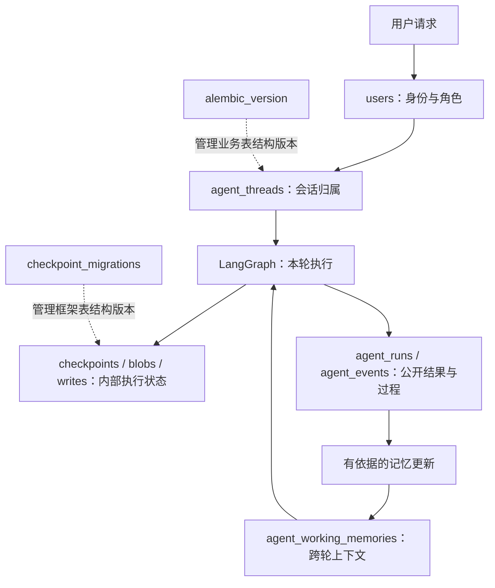

图中的箭头表示职责与读写流，不全部是数据库外键。公开 Run、工作记忆与 Checkpoint
是三种不同存储，不可互相替代；Checkpoint 也不能直接暴露给浏览器。

### 1.3 三种 ID 的关系

|标识|意义|生成/使用方式|
|---|---|---|
|`user_id`|账号身份|UUID，其他业务表通过 owner_user_id 引用|
|业务 `thread_id`|一段会话|服务生成 UUID 字符串，数据库存 TEXT|
|业务 `run_id`|一次请求|每次请求新生成 UUID 字符串，数据库存 TEXT|
|Checkpoint `thread_id`|一次隔离的图执行|本项目组合成 `user_id:业务thread_id:run_id`|
|`checkpoint_id`|一次图运行中的某个快照|由 LangGraph 生成|

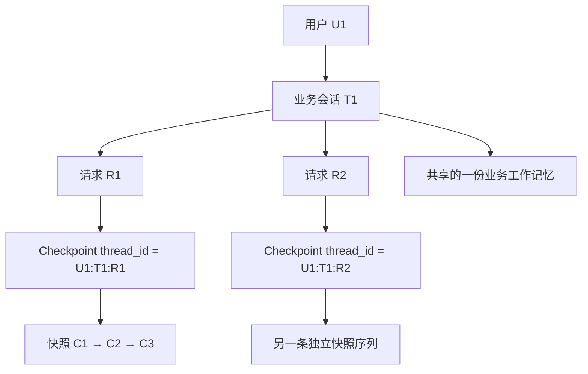

两次请求即使来自同一业务会话，也不会共用同一个图执行 thread key；跨轮上下文由
公开历史与工作记忆协调，不是直接复用上一轮的整个图状态。

## 2. 业务表关联

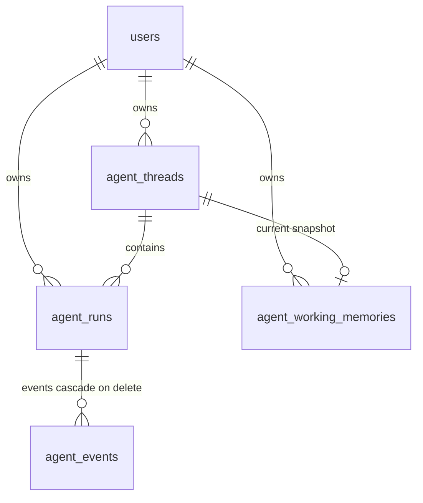

一个用户有多段会话，一段会话有多次 Run，一次 Run 有多个 Event；一段会话最多一份当前记忆。
图中这些关联对应实际外键。`last_run_id`、JSON 内的 ID 及 Checkpoint 关联不在这些外键中。

`agent_runs` 和记忆表都冗余保存 owner_user_id，便于 SQL 层按当前用户过滤。
但“owner 存在”和“thread 存在”两个独立外键并不自动保证 owner 就是 thread 的拥有者；
该一致性目前还依赖应用服务检查，详见第 12 节。

## 3. users：身份与权限

### 3.1 结构图与字段

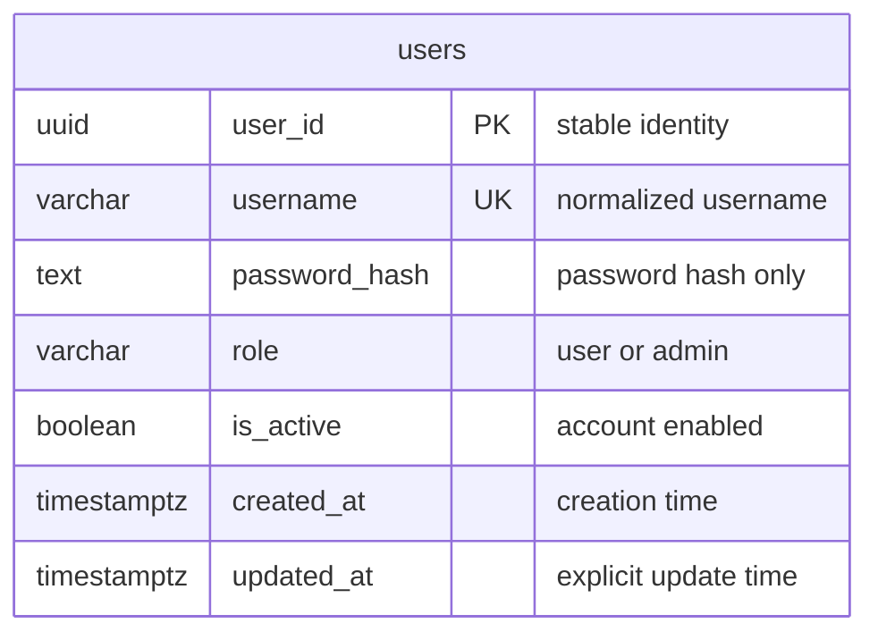

所有字段均 NOT NULL。

|字段|实际类型/默认值|作用|创建或修改时机|
|---|---|---|---|
|user_id|UUID，无数据库默认值|主键与稳定身份|Store 创建时 uuid4；正常不修改|
|username|VARCHAR(128)，无默认值|唯一登录名|创建时设置；目前没有改名接口|
|password_hash|TEXT，无默认值|项目密码哈希结果，不保存明文|创建时由 hash_password 生成；没有现成重置流程|
|role|VARCHAR(16)，默认 user|权限身份|创建时指定；目前没有角色调整接口|
|is_active|BOOLEAN，默认 true|账号启用状态|通过 set_active 修改|
|created_at|TIMESTAMPTZ，默认 CURRENT_TIMESTAMP|账号创建时间|首次插入后保留|
|updated_at|TIMESTAMPTZ，默认 CURRENT_TIMESTAMP|最近一次记录更新|set_active 显式更新|

### 3.2 约束与读取方式

- 主键：user_id。
- 唯一约束：username，自动对应唯一 B-tree 索引。
- CHECK：role 只能是 user 或 admin。
- 应用层用户名去首尾空白并 casefold；数据库唯一约束自身不是“不区分大小写唯一”。
- 登录按 username 查询并校验 is_active 与密码；解析 JWT 时按 user_id 再查账号，使用数据库当前角色。

登录成功不新增用户行、不更新 updated_at；当前没有 last_login_at 字段。
数据库也没有保存每个 JWT 的明细。禁用后 Token 再访问会因账号状态检查被拒绝。

### 3.3 应该如何修改

|需求|当前入口|修改字段|边界|
|---|---|---|---|
|创建普通账号|`python -m app.cli.users create-user <username>`|整行 INSERT|交互输入密码，不放入命令参数|
|创建管理员|`python -m app.cli.users create-admin <username>`|整行 INSERT，role=admin|同上|
|禁用账号|`python -m app.cli.users disable-user <user_id>`|is_active=false、updated_at|保留其历史数据|
|恢复账号|AuthenticationService / UserStore.set_active(..., True)|is_active=true、updated_at|Store 支持，但 CLI 尚无 enable 命令|
|改密码/改角色/改名|当前没有正式入口|需设计对应服务和权限后再修改|不能把字段存在当作功能已实现|

以上是维护入口说明，本次没有执行它们。一般不直接删用户：相关业务表外键未配置账号级级联删除。
迁移中的 `legacy-system` 是禁用历史归属账号，不应启用为普通登录账号。

## 4. agent_threads：会话目录

### 4.1 结构图与字段

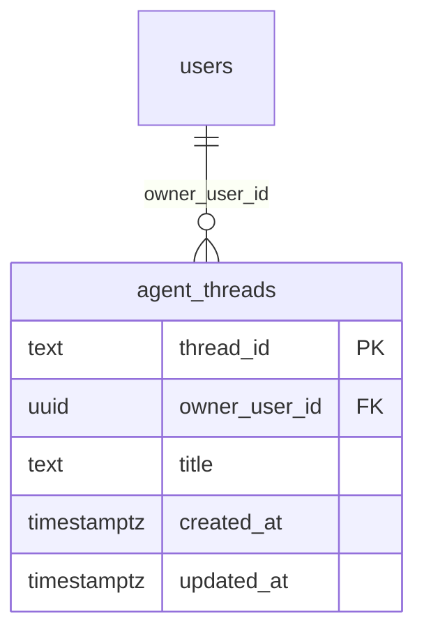

所有字段均 NOT NULL。

|字段|类型/默认值|作用|写入规则|
|---|---|---|---|
|thread_id|TEXT，无默认值|全局唯一业务会话主键|Store 生成 UUID 字符串；不更改|
|owner_user_id|UUID，无默认值|所属用户，FK → users.user_id|从认证后的当前用户传入，不接受用户伪造归属|
|title|TEXT，默认空字符串|前端会话目录标题|Store.create 支持传入；当前没有标题修改 API|
|created_at|TIMESTAMPTZ，默认当前时间|创建会话时间|INSERT 生成|
|updated_at|TIMESTAMPTZ，默认当前时间|最近会话活动排序依据|Run 保存后 touch_owned 显式 UPDATE|

### 4.2 读写方式与索引

`POST /api/agent/threads` 创建会话；服务在执行已有 thread_id 请求前检查 get_owned。
所有权读取条件同时包含 thread_id 和 owner_user_id。

索引 `idx_agent_threads_owner_updated(owner_user_id, updated_at, thread_id)` 支持某用户会话列表
按更新时间及 ID 排序。它不是对话内容索引；对话内容来自 agent_runs。

updated_at 是结果保存后的触达时间，不是每个 SSE 片段的时间，也不是正在执行请求的精确开始时间。
当前分页的 before 参数主要按更新时间筛选；若大量会话同时间戳，未来可考虑完整组合游标，尚未实现。

不应直接修改 thread_id 或 owner_user_id 来“转移会话”，否则 Run、记忆、Checkpoint 的关联需要一起处理。

## 5. agent_runs：公开运行结果

### 5.1 结构图与字段

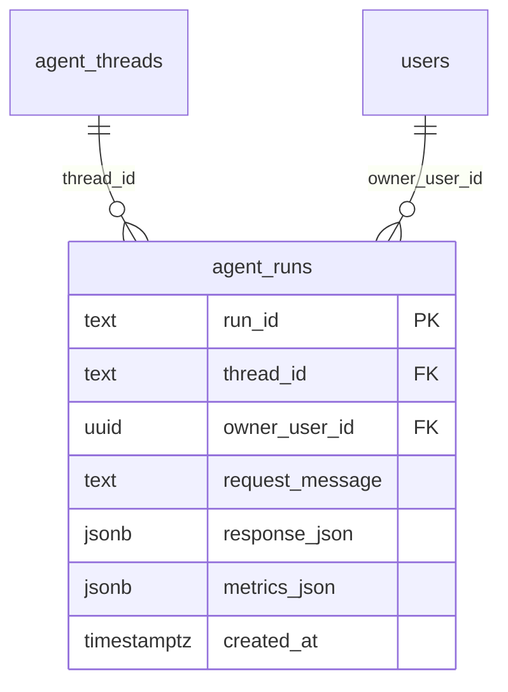

所有字段均 NOT NULL。

|字段|类型/默认值|作用|修改规则|
|---|---|---|---|
|run_id|TEXT，无默认值|一次请求唯一 ID|请求开始由服务生成；新请求用新 ID|
|thread_id|TEXT，无默认值|所属会话|结果保存时写入，正常不变|
|owner_user_id|UUID，无默认值|访问权限过滤|保存时写入，正常不变|
|request_message|TEXT，无默认值|本轮公开用户请求|保存时写入，历史不应任意改写|
|response_json|JSONB，无默认值|标准化公开响应|结束后写入；同 run_id 再保存时整体覆盖|
|metrics_json|JSONB，无默认值|运行指标|与响应同事务写入或整体覆盖|
|created_at|TIMESTAMPTZ，默认当前时间|此 Run 首次入库时间|INSERT 生成；UPSERT 不更新|

### 5.2 response_json 的键和值

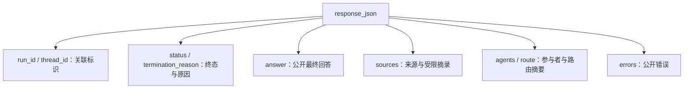

|JSON 键|值|用途与维护方式|
|---|---|---|
|run_id / thread_id|字符串|应与关系型列一致，由服务统一生成|
|status|completed / partial / failed|根据图结果标准化，不由工具直接修改数据库|
|answer|字符串|公开最终答案，不是全部原始模型响应|
|sources|对象数组|source_type、source_name、source_id、excerpt、metadata；保存引用来源|
|agents|Agent 名称数组|公开参与的职责单元|
|route|对象或 null|mode、target_agents、reason_summary；不是完整内部路由状态|
|errors|字符串数组|脱敏后的公开错误；不保存凭据或原始异常栈|
|termination_reason|字符串|例如 fast_path、review_passed、review_limit、all_specialists_failed|

status=completed 表示当前业务契约的完成状态，不证明所有自然语言结论准确。
有错误时，应通过 AgentResult → 图结果 → AgentRunResponse → RunStore 的链路表达；
不应让底层工具直接 UPDATE response_json.status。

### 5.3 metrics_json 的键和值

|JSON 键|作用|注意事项|
|---|---|---|
|duration_ms|运行耗时|用于指标统计，不等于 SQL 执行时间|
|dispatch_count|Specialist 调度次数|不是 Agent 种类数|
|tool_call_count|工具调用数|不同于模型调用数|
|task_step_count|Task 步骤数|用于复杂任务观测|
|failed / timed_out|失败及超时标记|由指标构造逻辑生成|
|model_calls|模型调用数，可空|空不是零|
|input_tokens / output_tokens|Token 统计，可空|当前不能据此承诺完整用量追踪|
|token_cost|成本，可空|没有数据时不能声称零成本|

### 5.4 保存、读取与不可误解的时间语义

正常链路在结束后统一保存公开结果，不是先 INSERT running 再按节点持续 UPDATE。
因此 created_at 主要表示第一次保存时间，不能替代精确请求开始时间；同会话并发请求的历史
按 `(created_at, run_id)` 排列，也不等于严格按用户提交顺序。

PostgresRunStore.save 使用 `ON CONFLICT(run_id) DO UPDATE`，目前允许重写 owner、thread、
request、response、metrics；这只是底层存储行为，不应当作为任意迁移运行归属的业务功能。
业务重试通常创建新 Run；重复保存同 Run 需要确保输入标识与归属一致。

主要读接口：Run 查询、Trace 查询、会话历史和聚合 Metrics。
当前 Metrics 读取 metrics_json 后在应用层聚合，不是数据库中已有专门聚合指标表。

## 6. agent_events：公开执行事件

### 6.1 结构图与字段

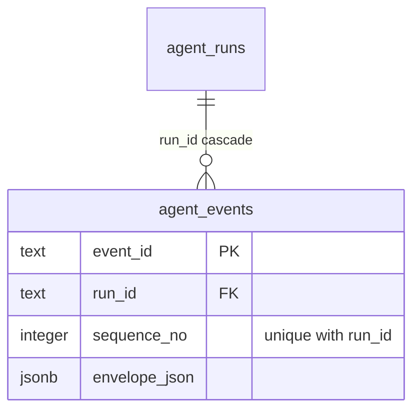

所有关系型列均 NOT NULL；agent/node 在 JSON 中可以为空。

|字段|类型|用途|生成/修改方式|
|---|---|---|---|
|event_id|TEXT|唯一事件身份|事件创建时生成|
|run_id|TEXT|FK → agent_runs.run_id|绑定本次 Run|
|sequence_no|INTEGER|Run 内回放顺序|save 对事件列表 enumerate，当前从 0 起|
|envelope_json|JSONB|完整公开事件信封|EventService 标准化，RunStore 保存|

约束：PK(event_id)，UK(run_id, sequence_no)，Run 外键 ON DELETE CASCADE。
相同 run_id 不能有两个同序号事件，但 sequence_no 无“非负”数据库 CHECK；顺序由应用分配。

### 6.2 envelope_json

|键|含义|
|---|---|
|event_id / run_id / thread_id|事件和关联身份，应与关系型列保持一致|
|type|run_started、route_decided、tool_completed、content_delta、run_completed 等公开事件类型|
|timestamp|事件生成时间；不是事件整批落库时间|
|agent / node|公开 Agent 或节点名，可空|
|data|随事件类型变化的公开 payload，经过长度限制与脱敏|

Trace 按 sequence_no 读取，不依赖同一时刻事件 timestamp 的唯一性。部分业务完成状态
partial 可以通过 run_completed 终态事件表达，必须检查 result.status，不能只看事件名。

### 6.3 事件不是独立实时落库的审计流水

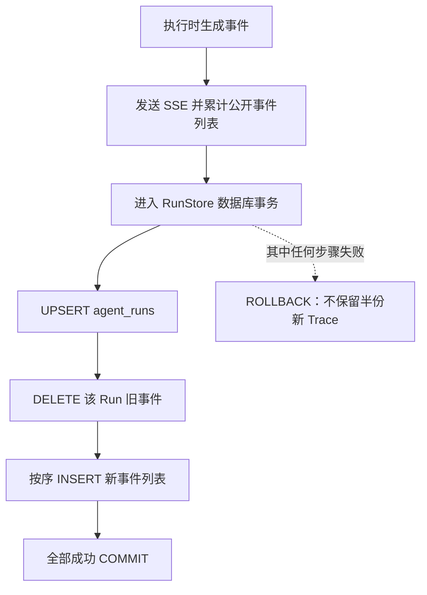

Run 与 Events 同事务保存。重复保存同 Run 会删除旧事件再重建，不是严格不可变的审计日志。
执行中进程中断或客户端取消时，不能保证之前发出的所有 SSE 都已出现在 agent_events 中。

## 7. agent_working_memories：跨轮记忆

### 7.1 结构图与字段

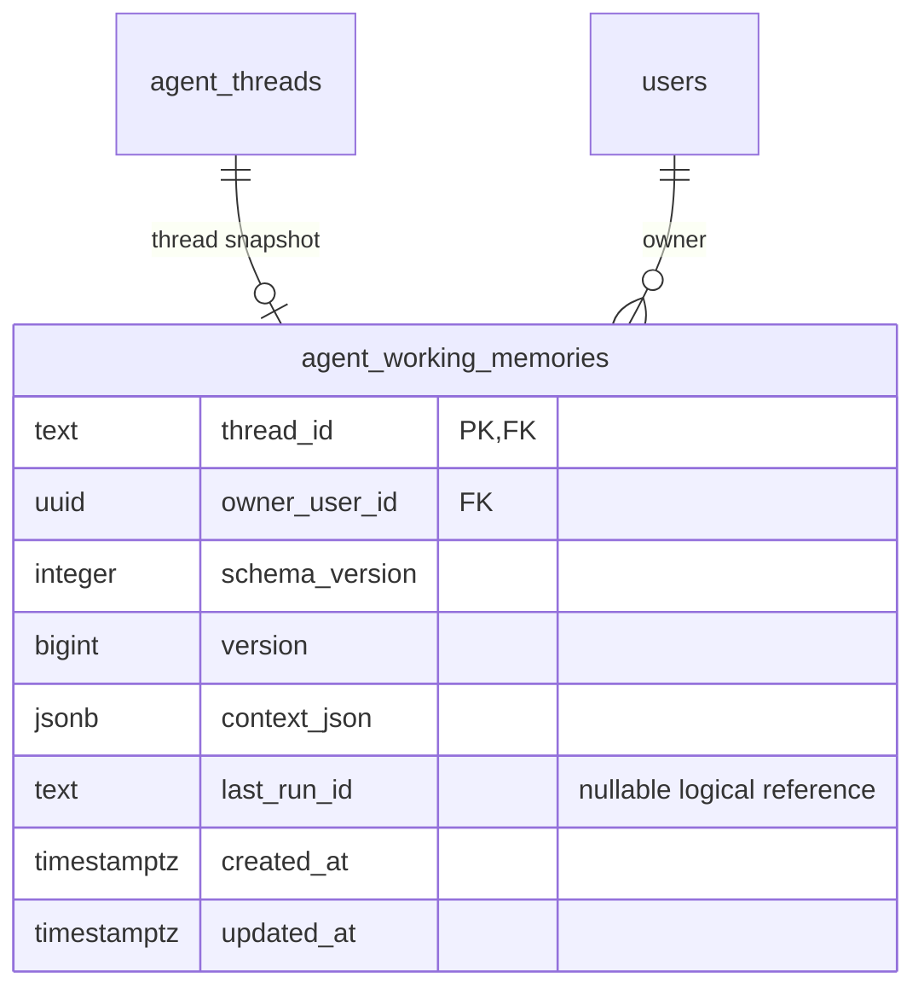

除 last_run_id 外均 NOT NULL。

|字段|类型/默认值|作用|更新规则|
|---|---|---|---|
|thread_id|TEXT，无默认值|主键与会话外键；一会话最多一行|创建时确定，不改变|
|owner_user_id|UUID，无默认值|用户外键与查询过滤|创建时确定，不改变|
|schema_version|INTEGER，默认 1|context_json 格式版本|仅格式演进时改，不随每次请求加一|
|version|BIGINT，默认 1|记忆修订版本，CAS 使用|初始 1，有效更新时加一|
|context_json|JSONB，无默认值|有界上下文快照|Reducer 生成，校验后整体写入|
|last_run_id|TEXT，可空|最近实际更新记忆的业务 Run|有效更新时改变；没有 FK|
|created_at|TIMESTAMPTZ，默认当前时间|首次记忆创建时间|后续保留|
|updated_at|TIMESTAMPTZ，默认当前时间|本次记忆更新时间|每次有效更新显式传入|

CHECK：schema_version >= 1、version >= 1、context_json 顶层为 JSON 对象、
updated_at >= created_at。数据库没有逐条校验 JSON 里的证据和动态时间字段，应用模型负责。

### 7.2 context_json 与证据的结构

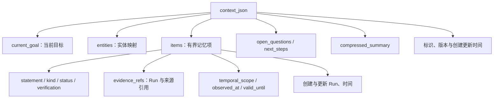

|键|作用|当前维护边界|
|---|---|---|
|current_goal|当前案件目标|Reducer 使用公开请求更新|
|entities|实体名称到值的映射|当前 Reducer 保留已有值，不是完整自动实体更新流程|
|items|最多 100 条的类型契约上限，配置可更严格|加入公开请求陈述和有证据观察；去重、替代和裁剪|
|open_questions|待确认项|从执行错误等构造并有界合并|
|next_steps|下一步|根据未完成事项构造，不能据此推断已自动执行|
|compressed_summary|受约束压缩摘要|由可选 Compressor 在条件满足时更新|
|schema_version / version / IDs / 时间|快照自描述信息|关系型列中也保存，加载时列值覆盖 JSON 对应值|

items 内部字段：

|字段组|值与含义|修改责任|
|---|---|---|
|item_id|一条记忆项身份|服务端生成|
|kind|user_claim / evidence_observation / conclusion / decision|模型契约定义；当前并非全部类型都有完整自动生成闭环|
|statement|受长度限制的陈述|来源于公开请求或证据，不保存隐藏思维链|
|status|active / superseded / resolved|Reducer 会替代同 query_scope 的旧动态观察；resolved 不代表已具备完整解决事项流程|
|verification|unverified / supported|用户陈述不是自动证明；supported 必须有证据引用|
|evidence_refs|run_id、agent_name、source_type/name/id、excerpt、observed_at|服务生成安全来源引用；不是数据库外键|
|temporal_scope|静态或动态时间作用域|决定是否需要时效检查|
|observed_at / valid_until|观察与失效时间|动态证据必须有带时区的观察时间，TTL 由服务策略赋值|
|query_scope|同类查询事实的作用域|用于识别应被新观察替代的旧观察|
|created_run_id / updated_run_id|记忆项来自哪次 Run、哪次更新|随新增/替代同步维护|
|created_at / updated_at|项创建与更新时间|带时区，时间顺序由模型校验|

过期不等于数据库自动 DELETE。上下文视图筛选并标记过期事实，动态事实应重新查工具；
新证据写入后，旧观察可变为 superseded。当前没有后台定时任务自动删除所有过期 JSON 项。

### 7.3 创建、CAS 和幂等边界

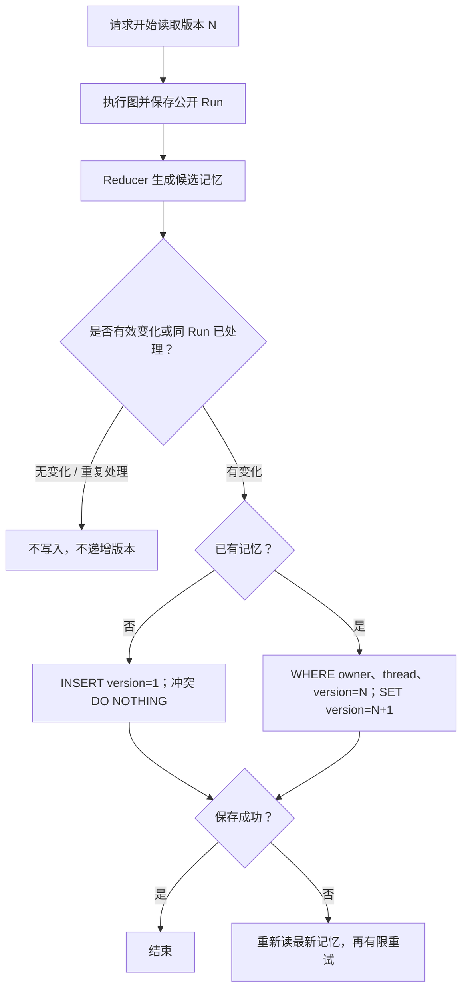

CAS 的含义是比较旧版本、更新新版本；不是“先查后不加条件地覆盖”。默认配置允许一次
额外重试。SQL 更新同时改变 context_json、version、last_run_id、schema_version、updated_at。

两个并发请求都读到 version=5 时，第一个提交 6，第二个 WHERE version=5 匹配不到行，
然后重新加载并合并自己的更新。达到重试上限后记录警告，不无限循环。

Reducer 发现 last_run_id 等于当前 run_id 时可跳过重复更新，但这不是一套记录所有历史 Run
的全局幂等日志。CAS 也只防止写覆盖，不保证同会话两条请求按发送顺序执行。

记忆失败不会主动掩盖已保存的公开 Run：当前顺序是先 Run/Events，后 touch 会话，再尝试记忆。
它们不是覆盖所有存储的同一个原子事务。

## 8. LangGraph 三张执行状态表

以下是当前安装依赖实现的结构；框架升级可能改变内部格式。关联由 Saver 按键与版本恢复，
数据库没有为三表建立互相引用的 FK。不要把下图当作外键 ER 图。

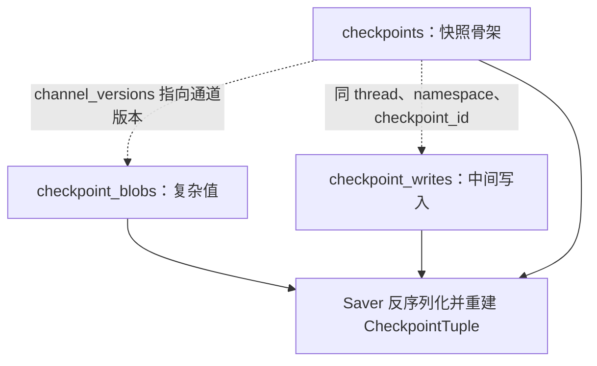

### 8.1 checkpoints：快照骨架

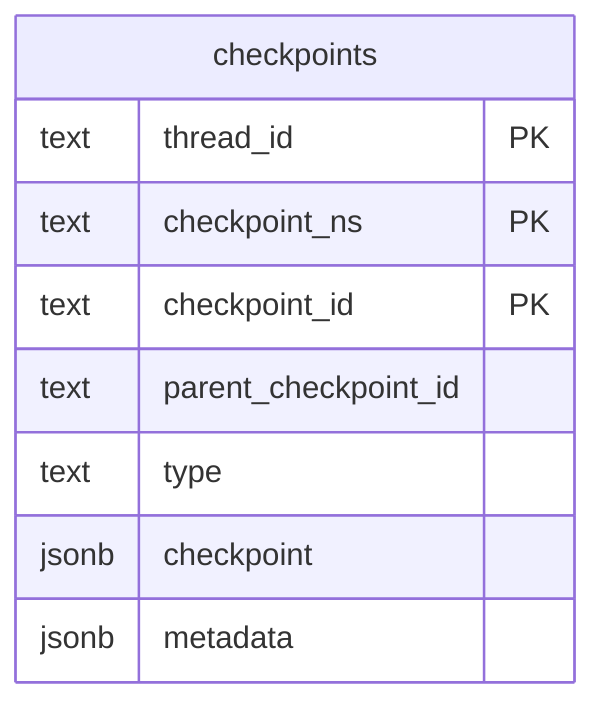

|字段|类型/可空/默认|含义与修改方式|
|---|---|---|
|thread_id|TEXT，非空|本项目 user:thread:run 组合隔离键|
|checkpoint_ns|TEXT，非空，默认空字符串|命名空间；不直接假设等于 Agent 名称|
|checkpoint_id|TEXT，非空|快照 ID，和前两列构成 PK|
|parent_checkpoint_id|TEXT，可空|父快照指针，没有 FK|
|type|TEXT，可空|类型字段；当前主要 aput 保存 SQL 不写它|
|checkpoint|JSONB，非空|快照结构，不等于全部复杂状态值都内联于此|
|metadata|JSONB，非空，默认空对象|来源、step、parents 等框架元信息|

checkpoint JSON 的核心键：v（格式版本）、id、ts、channel_values、channel_versions、
versions_seen、updated_channels。channel_values 是状态通道值；versions_seen 记录节点已读版本，
用于判断后续执行，不是业务表更新版本。metadata 中的框架 run_id 也不能无条件视作业务 run_id。

当前 Saver 内联空值、字符串、数字、布尔等简单状态值，复杂值主要保存到 blobs。
图运行调用 aput 自动保存快照；联合键冲突时更新 checkpoint 和 metadata，不更新父指针。

正常业务修改应返回图状态字段增量，由 LangGraph 完成 Reducer 与 Checkpoint 保存；
不要手动更改 versions_seen、channel_versions 或父快照指针。Checkpointer 支持状态保存，
不等于当前业务 API 已实现失败后自动恢复任务的完整流程。

### 8.2 checkpoint_blobs：版本化通道值

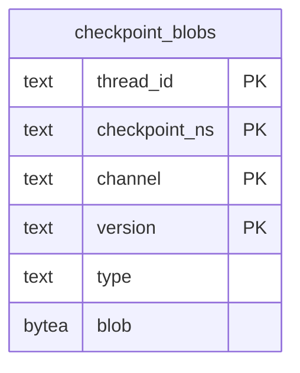

|字段|类型/可空/默认|含义与修改方式|
|---|---|---|
|thread_id|TEXT，非空|图运行隔离键|
|checkpoint_ns|TEXT，非空，默认空字符串|命名空间|
|channel|TEXT，非空|状态字段或内部通道名|
|version|TEXT，非空|通道版本；不是工作记忆的 BIGINT version|
|type|TEXT，非空|序列化类型标记，协助反序列化|
|blob|BYTEA，可空|对应版本的序列化值；不是向量或文档文件|

PK 为 `(thread_id, checkpoint_ns, channel, version)`，刻意不含 checkpoint_id。

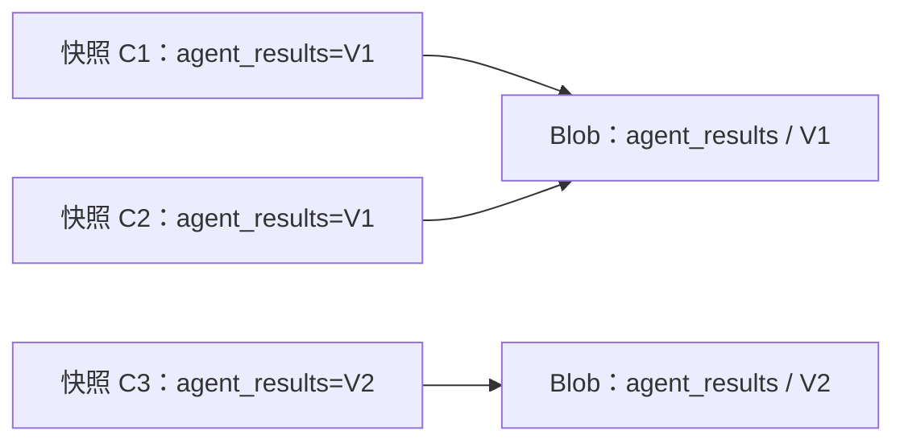

字段未变时多个快照可引用同一版本；新版本只需存一次。当前 aput 对新版本插入，
相同联合键使用 DO NOTHING。修改旧 blob 会影响所有引用该版本的快照，不能当普通 JSON
手工替换；应让框架生成新版本。读取应通过 Saver，而非自行猜测 BYTEA 编码。

### 8.3 checkpoint_writes：节点中间写入

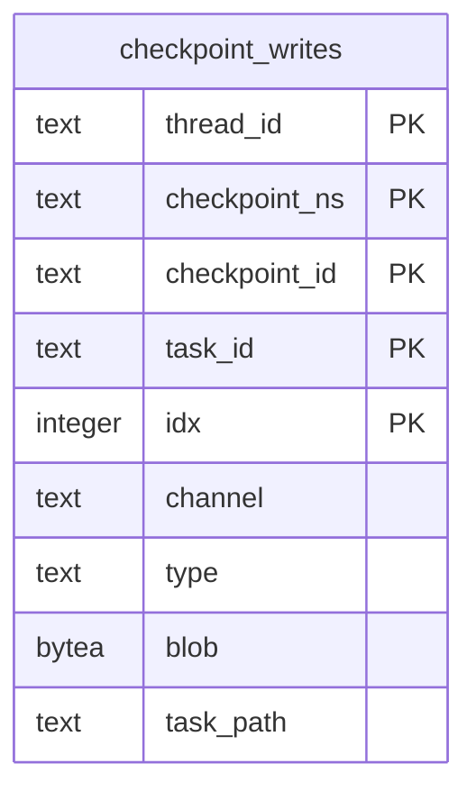

|字段|类型/可空/默认|作用|
|---|---|---|
|thread_id|TEXT，非空|图运行隔离键|
|checkpoint_ns|TEXT，非空，默认空字符串|命名空间|
|checkpoint_id|TEXT，非空|关联某个快照；没有 FK|
|task_id|TEXT，非空|框架执行任务身份，不等同于业务 AgentTask.task_id|
|idx|INTEGER，非空|任务内写入序号；错误、暂停等特殊通道可能是负数|
|channel|TEXT，非空|写入哪个状态/内部通道|
|type|TEXT，可空|序列化类型标记|
|blob|BYTEA，非空|中间写入值|
|task_path|TEXT，非空，默认空字符串|框架内部任务路径，不是文件系统路径|

PK 为 `(thread_id, checkpoint_ns, checkpoint_id, task_id, idx)`。这张表用于保存 pending writes，
例如并行节点之一完成而另一个未完成时的已产生结果；不是公开事件日志或最终答案表。

aput_writes 自动保存；普通写入同联合键重复时通常 DO NOTHING，框架特殊通道可使用 UPSERT
更新 channel/type/blob。不要手工修改 idx 或 task_id 来“补步骤”。相关记录由 Saver 协调清理。

## 9. 迁移版本表

### 9.1 alembic_version

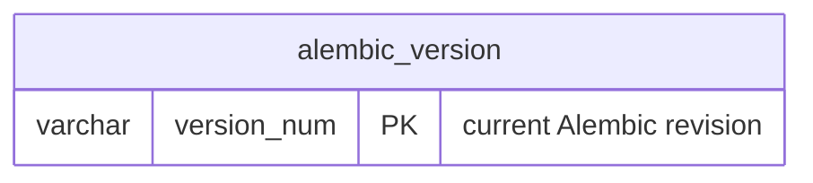

唯一字段 version_num 为非空 VARCHAR 主键，当前实际记录为 `20260919_0004`。
它代表业务 Schema 当前迁移版本，不是 Run、模型或工作记忆版本。Alembic 支持分支版本，
不要把“此刻只有一行”当作数据库强制只能一行的约束。

结构变化应新增迁移文件，再由 Alembic upgrade/downgrade 更新此表。直接改版本号不能使
缺失字段、索引或外键出现，还会使后续迁移误判状态。

### 9.2 checkpoint_migrations

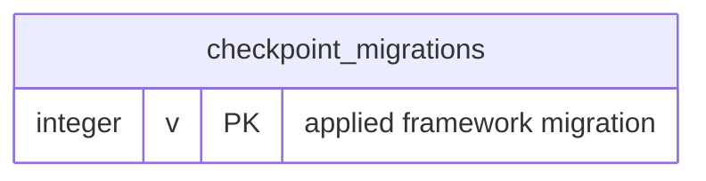

唯一字段 v 为非空 INTEGER 主键，每行代表一条已执行框架迁移。当前实际记录为 0～9。
其中包括框架建表、索引、task_path 等迁移，也包括依赖内部保留的空操作迁移；不是每个数字
都对应一张新表。由 AsyncPostgresSaver.setup 执行迁移并登记，普通请求不修改。

### 9.3 两套迁移统一入口

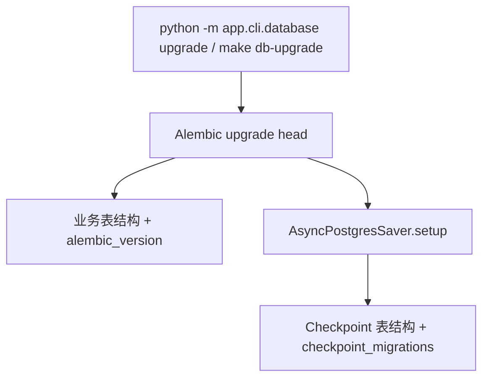

这是维护命令说明，不是本次执行记录。正常启动主要校验必需表存在，不静默创建业务表或
回退到内存；单纯“表存在”检查也不是完整版本和约束一致性检查。

## 10. 请求、并发与删除时序

### 10.1 正常请求全过程

```mermaid
sequenceDiagram
    participant U as 用户
    participant S as 服务
    participant B as 业务表
    participant G as LangGraph
    participant C as Checkpoint表
    participant M as 记忆表
    U->>S: 登录
    S->>B: 读 users 并验证密码、状态
    U->>S: 创建会话
    S->>B: INSERT agent_threads
    U->>S: 请求已有会话
    S->>B: 校验会话所属用户
    S->>M: 读工作记忆
    S->>B: 读有限近期公开历史
    S->>G: 新 run_id 与独立隔离键
    loop 图执行
        G->>C: 保存快照、通道值、中间写入
        G-->>S: 公开事件与内容片段
        S-->>U: SSE
    end
    S->>B: 单事务保存 Run 与 Events
    S->>B: touch 会话 updated_at
    S->>M: 有效变化时创建或 CAS 更新
    S-->>U: 唯一终态
```

以上描绘正常 SSE 路径；同步 API 也复用标准化结果和持久化协调，不发送 SSE。
若异常、取消或存储失败发生，不能把上述完整顺序当作必然全部成功。

### 10.2 并发时哪些数据共享

|对象|不同请求是否共享|保护方式|不是保证什么|
|---|---|---|---|
|用户记录|同用户共享|数据库约束、应用权限检查|不是逐请求独立账号|
|会话目录|同会话共享|所有权过滤，更新活动时间|不保证消息提交顺序|
|Run/Event|新请求新 run_id|主键、事件序号唯一、事务保存|不是严格不可变审计|
|Checkpoint|本项目按 user:thread:run 隔离|框架联合键|不能代替会话记忆|
|工作记忆|同业务会话共享|版本 CAS、冲突重新加载、有限重试|不保证两请求互相看到最新结果|

即使 CAS 最终合并成功，两个请求开始时可能都读取同一份旧记忆。真正有前后依赖的同会话
请求，需要业务串行或排队设计；当前不能宣称已有严格会话级顺序执行保障。

### 10.3 会话删除顺序

```mermaid
flowchart TD
    CHECK["校验当前用户拥有会话"] --> MEM["删除该会话工作记忆"]
    MEM --> RUN["删除该用户该会话 Runs，返回 run_ids"]
    RUN --> EV["数据库 ON DELETE CASCADE 删除 Events"]
    EV --> CP["逐 run_id 调用 Saver 删除组合 thread key"]
    CP --> THREE["清理 checkpoints、checkpoint_blobs、checkpoint_writes"]
    THREE --> TH["删除 agent_threads"]
```

入口：`DELETE /api/agent/threads/{thread_id}` → MultiAgentService.clear_thread。
只有 Run → Events 是数据库自动级联；其他业务外键没有全套 CASCADE，Checkpoint 无业务 FK。
清理跨多个方法，不是整体原子事务，失败时可能部分完成。

特别注意：服务按公开 Run 返回的 run_ids 清理图状态。若执行已产生 Checkpoint 但公开 Run
未成功保存，该图状态可能不在此列表中；当前不能保证覆盖所有这种孤立状态。
直接 DELETE 一个业务表不等于完整清理会话，必须走协调服务并考虑并发中的请求。

## 11. 约束、索引与修改规则汇总

### 11.1 现有主要索引

|表|索引/约束|用途|
|---|---|---|
|users|PK(user_id)、UK(username)|按账号 ID / 用户名查询与去重|
|agent_threads|PK(thread_id)|定位会话|
|agent_threads|idx_agent_threads_owner_updated(owner_user_id, updated_at, thread_id)|用户会话目录及排序|
|agent_runs|PK(run_id)|定位/UPSERT Run|
|agent_runs|idx_agent_runs_thread(thread_id, created_at, run_id)|会话历史|
|agent_runs|idx_agent_runs_owner_thread_created(owner_user_id, thread_id, created_at, run_id)|用户隔离历史查询|
|agent_events|PK(event_id)、UK(run_id, sequence_no)|事件唯一与有序回放|
|agent_events|idx_agent_events_run(run_id, sequence_no)|按 Run 查询事件；与上述唯一索引列相同，存在重复索引候选|
|agent_working_memories|PK(thread_id)|定位会话快照，CAS 同行更新|
|checkpoints|联合 PK + thread_id 单列索引|定位快照、按图运行查询与删除|
|checkpoint_blobs|联合 PK + thread_id 单列索引|按通道版本恢复、运行清理|
|checkpoint_writes|联合 PK + thread_id 单列索引|读取 pending writes、运行清理|
|alembic_version / checkpoint_migrations|各自 PK|版本唯一|

联合 B-tree 主键本身也能服务部分前缀查询；不能仅凭列重复就直接删除框架维护的索引。
当前没有针对 response_json/context_json 的 GIN 索引，不应宣称任意 JSON 条件查询已被优化。
索引增删应通过迁移、结合真实查询计划分析，而不是本文直接修改。

### 11.2 应该通过什么方式修改什么值

|场景|正常入口/责任模块|应该改变|不应该直接改变|
|---|---|---|---|
|新建账号|认证服务 / 用户 CLI|users 新行|手工填明文 password_hash|
|禁用账号|set_active / disable-user|is_active、updated_at|删除用户及所有外键记录|
|创建会话|create_thread / ThreadStore|agent_threads 新行|伪造 owner_user_id|
|处理新请求|MultiAgentService / Graph|新 run_id、图状态、最终公开 Run/Events|复用旧 run_id 冒充新请求|
|路由或 Agent 结果改变|节点返回状态增量|图状态及框架快照|手改 Checkpoint 调度版本|
|生成最终结果|RunStore.save|response_json、metrics_json、完整事件列表|只改 status、不维护证据与错误|
|记忆中新事实出现|Reducer / MemoryStore|候选快照、version、last_run_id、updated_at|无 CAS 覆盖 context_json|
|动态事实过期|上下文筛选 / 重新查工具|新证据，按规则替代旧观察|延长旧 valid_until 假装重新查询|
|删除会话|clear_thread|关联业务记录和框架状态协调清理|只删某一张表就认为清理完毕|
|业务 Schema 演进|Alembic 迁移|DDL 与 alembic_version|只编辑迁移版本号|
|框架 Schema 演进|Saver.setup / 升级入口|框架表结构与迁移记录|直接填 checkpoint_migrations.v|

此表是设计与维护规则，不授权读者直接操作生产数据。人工数据修复需单独确认范围、备份、
所有权与一致性，并通过经过审查的修复流程完成。

## 12. 当前边界与后续设计方向

以下为待评估方向，不是本次新增能力。

|当前边界|为什么重要|可评估方向|
|---|---|---|
|owner 与 thread 是独立 FK|数据库不能阻止归属不一致的人工写入|组合唯一键与组合 FK；先审查现有数据与写路径|
|标识在列与 JSON 中重复|单边修改造成公开契约与查询不一致|统一服务构造、校验及必要的 DB CHECK|
|updated_at 没有自动更新触发器|默认值只影响 INSERT|继续明确由服务负责，或一致地设计触发器|
|公开 Run 主要结束后保存|中断可能留 Checkpoint 而无完整公开历史|运行登记、取消状态、孤立状态回收策略|
|Run UPSERT 可覆盖归属|底层存储没有强制历史不可变|限定同 ID 归属一致与重写权限|
|Events 成批重建|不能作为严格不可变实时审计|必要时独立设计持久化事件流水，不混淆现有 Trace|
|记忆与公开结果分开提交|Run 已保存但记忆更新可能失败|明确可恢复一致性、监控失败和补偿策略|
|会话删除不是整体事务|失败或并发请求可能留下部分数据|删除标记、幂等重试、阻止删除中会话新运行|
|跨轮记忆一行快照|不保存全部记忆版本历史|确有审计需求时另设版本历史，不无限扩大快照|
|长期 Run/Checkpoint 累积|磁盘增长与查询维护成本|按数据保留策略定向清理；不能只删 blob|
|框架 BYTEA 是内部序列化|内部状态不应公开，格式随依赖变更|限制 DB 权限、通过 Saver 读取并保护备份|

还有两个容易夸大的点：Checkpoint 可用于框架恢复，不意味着已实现完整业务自动恢复；
有 MemoryItem / WorkingMemoryUpdate 的字段契约，不意味着全部实体、结论、决策、已解决事项
都有自动提取、更新和清理流程。

连接池属于访问资源配置，不是表结构。当前默认 min=1、max=10、等待超时 10 秒，环境变量
可覆盖；PersistenceFactory 与认证服务分别可创建自己的池，不能简单说整个进程一定仅有一个池。
并发 HTTP 请求数不等于同时占用 SQL 连接数，本文不根据池默认值推断运行容量。

## 13. 源码与验证依据

### 13.1 业务迁移

|文件|说明|
|---|---|
|[20260828_0001_agent_run_store.py](../../migrations/versions/20260828_0001_agent_run_store.py)|Run/Event 与初始索引、事件外键|
|[20260913_0002_agent_working_memories.py](../../migrations/versions/20260913_0002_agent_working_memories.py)|记忆快照与 CHECK|
|[20260919_0003_users.py](../../migrations/versions/20260919_0003_users.py)|用户表、角色及用户名约束|
|[20260919_0004_user_owned_threads.py](../../migrations/versions/20260919_0004_user_owned_threads.py)|用户所属会话、历史隔离、UUID owner、外键与索引|

历史迁移曾把记忆 owner_user_id 设为 TEXT，当前已转为 UUID。阅读旧迁移时应结合全部迁移，
不能把初始 DDL 当作现有结构。旧历史通过禁用 legacy-system 账号隔离，不自动归属某个真实用户。

### 13.2 服务与契约

|文件|应核对的行为|
|---|---|
|[user_store.py](../../app/services/user_store.py)、[auth/service.py](../../app/auth/service.py)|账号创建、状态修改、登录和 Token 当前用户检查|
|[cli/users.py](../../app/cli/users.py)|真实存在的用户维护入口|
|[thread_store.py](../../app/services/thread_store.py)|会话创建、所有权、touch、排序和删除|
|[run_store.py](../../app/services/run_store.py)|UPSERT、事件重建、事务、公开查询与 Metrics 聚合|
|[models/agent.py](../../app/models/agent.py)|response_json、metrics_json、envelope_json 公共契约|
|[working_memory_store.py](../../app/services/working_memory_store.py)|加载列覆盖 JSON、创建冲突、CAS|
|[memory/contracts.py](../../app/agent/memory/contracts.py)、[memory/reducer.py](../../app/agent/memory/reducer.py)|快照约束与当前实际更新逻辑|
|[memory/compressor.py](../../app/agent/memory/compressor.py)、[memory/context.py](../../app/agent/memory/context.py)|压缩及跨轮上下文选择|
|[multi_agent_service.py](../../app/services/multi_agent_service.py)|结果先保存、记忆后更新、SSE 终态与删除协调|
|[agent/graph.py](../../app/agent/graph.py)|user:thread:run 隔离键与 Checkpoint 删除|
|[runtime/checkpointer.py](../../app/agent/runtime/checkpointer.py)、[persistence.py](../../app/services/persistence.py)|Saver 与连接池生命周期|
|[cli/database.py](../../app/cli/database.py)|两套迁移统一升级入口|

框架三表依据本地安装包 `langgraph/checkpoint/postgres/base.py` 与 `aio.py` 的迁移、SQL、
aput、aput_writes、adelete_thread 实现；BYTEA 的具体编码以同版本 Serializer 为准。

### 13.3 检查范围与真实性

此次只读核对了 information_schema 列、pg_constraint 约束及两套迁移版本；索引说明结合
上一轮元数据核对和当前迁移/Saver 定义。没有执行真实数据内容查询或数据库写入。

相邻测试可参考：

- [test_postgres_persistence.py](../../tests/integration/test_postgres_persistence.py)：共享存储、并发保存、事件重写/回滚、记忆 CAS、约束和删除。
- [test_postgres_users.py](../../tests/integration/test_postgres_users.py)：用户存储。
- [test_working_memory_store.py](../../tests/unit/test_working_memory_store.py)：记忆存储契约。

本次是文档任务，没有运行会写入数据库的集成测试；测试文件存在不等于本轮执行通过。
文档校验以 Markdown 结构、Mermaid 语法、表覆盖、源码链接和 diff 检查为主。

## 总结

业务表保存“谁在什么会话中发起了请求、公开结果与过程是什么”；工作记忆保存“下一轮应该
继承什么有来源、有限且有时效的上下文”；Checkpoint 保存“本轮图执行到了哪里、哪些通道
是什么版本”。两张迁移表则管理这些结构本身的版本。

正常修改应由所属服务或框架执行，并同步维护标识、来源、版本、时间与关联；不要跨层只改
一个 JSON 键，就认为整个运行、记忆或图状态已被正确修复。
